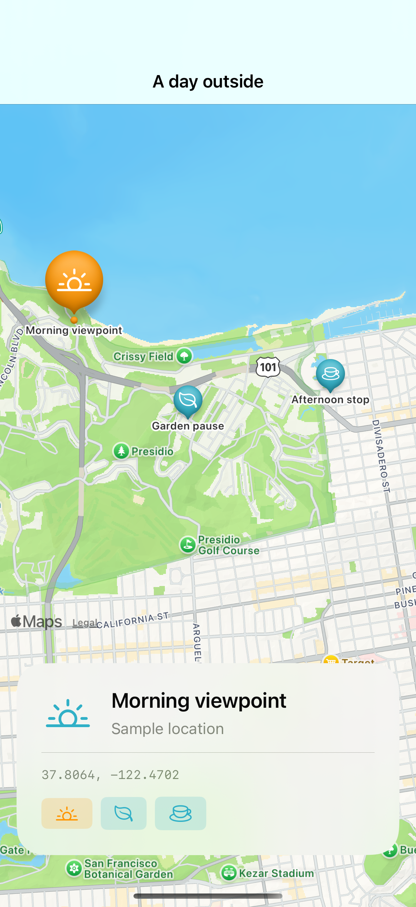

# Markers and selected place cards

Tagged map content drives a selected place card; these clearly labeled sample locations remain useful even when base-map imagery has not loaded.

## SwiftUI

```swift
import SwiftUI
import MapKit

struct SelectedMarker: View {
    @State private var selected: String?
    var body: some View {
        Map(selection: $selected) {
            Marker("Sample stop", coordinate: CLLocationCoordinate2D(latitude: 37.8064, longitude: -122.4702))
                .tag("stop")
        }
        .safeAreaInset(edge: .bottom) {
            if selected == "stop" { Text("Sample stop selected").padding().background(.regularMaterial) }
        }
    }
}
```

## Captures

<!-- captures:start -->
### iPhone 16 Pro · iOS 18.5

default. light appearance; Large text; en_US.


<!-- captures:end -->

## Full example

[Open the complete runnable example](MapPlaceSelectionDemo.swift).

## Reference

[Apple: Map(selection:)](https://developer.apple.com/documentation/mapkit/marker).
