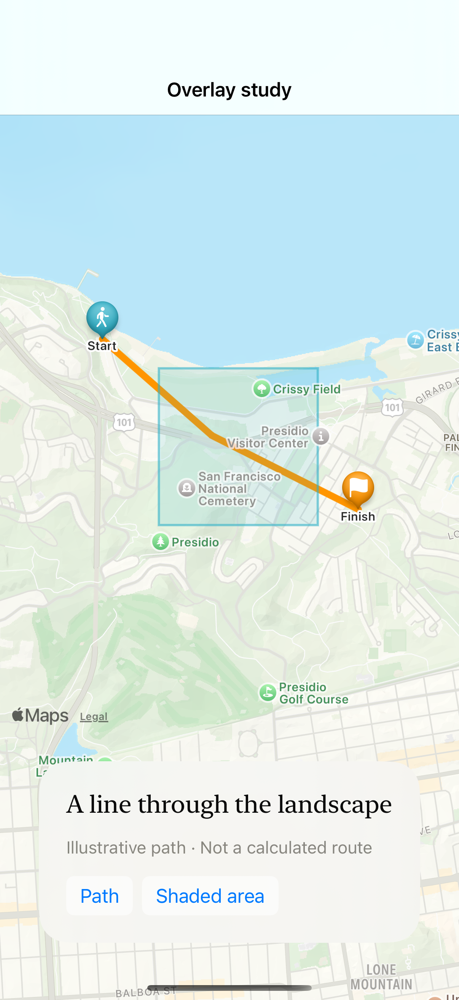

# Paths and region overlays

Polyline and polygon overlays visualize supplied coordinates; this hand-authored example is an illustrative path, not a calculated route or navigation advice.

## SwiftUI

```swift
import SwiftUI
import MapKit

struct SuppliedPath: View {
    private let coordinates = [CLLocationCoordinate2D(latitude: 37.8063, longitude: -122.4692), CLLocationCoordinate2D(latitude: 37.7987, longitude: -122.4547)]
    var body: some View {
        Map {
            MapPolyline(coordinates: coordinates)
                .stroke(.teal, style: StrokeStyle(lineWidth: 5, lineCap: .round))
        }
    }
}
```

## Captures

<!-- captures:start -->
### iPhone 16 Pro · iOS 18.5

default. light appearance; Large text; en_US.


<!-- captures:end -->

## Full example

[Open the complete runnable example](MapRouteOverlaysDemo.swift).

## Reference

[Apple: MapPolyline](https://developer.apple.com/documentation/mapkit/mappolyline).
