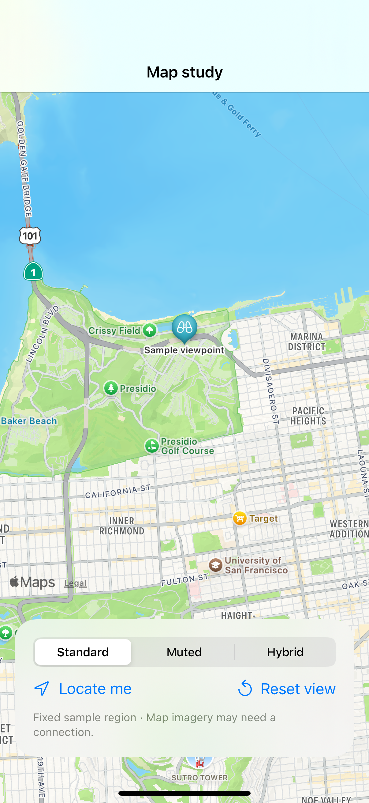

# Map styles and location access

A fixed sample region supports map-style comparisons; locating the user is a separate action that requires app configuration, permission, and a location fix.

## SwiftUI

```swift
import SwiftUI
import MapKit

struct FixedMapRegion: View {
    @State private var position = MapCameraPosition.region(MKCoordinateRegion(
        center: CLLocationCoordinate2D(latitude: 37.8024, longitude: -122.455),
        span: MKCoordinateSpan(latitudeDelta: 0.05, longitudeDelta: 0.05)))
    var body: some View {
        Map(position: $position)
            .mapStyle(.standard(elevation: .realistic))
            .mapControls { MapCompass(); MapPitchToggle(); MapScaleView() }
    }
}
```

## Captures

<!-- captures:start -->
### iPhone 16 Pro · iOS 18.5

default. light appearance; Large text; en_US.


<!-- captures:end -->

## Full example

[Open the complete runnable example](MapStylesLocationDemo.swift).

## Reference

[Apple: Map](https://developer.apple.com/documentation/mapkit/map).
