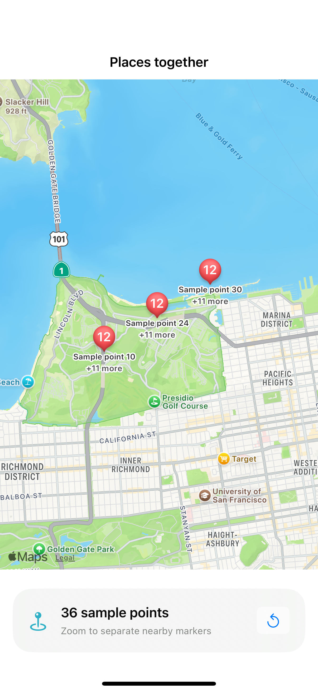

# Native annotation clustering

Annotations with the same clustering identifier group when their views collide; these deterministic sample points use MapKit’s native cluster rendering.

## SwiftUI

```swift
import SwiftUI
import MapKit

struct ClusteringMap: UIViewRepresentable {
    let coordinates: [CLLocationCoordinate2D]
    func makeCoordinator() -> Coordinator { Coordinator() }
    func makeUIView(context: Context) -> MKMapView {
        let map = MKMapView(); map.delegate = context.coordinator
        map.register(MKMarkerAnnotationView.self, forAnnotationViewWithReuseIdentifier: "place")
        let annotations = coordinates.map { coordinate in
            let annotation = MKPointAnnotation(); annotation.coordinate = coordinate; return annotation
        }
        map.addAnnotations(annotations); map.showAnnotations(annotations, animated: false)
        return map
    }
    func updateUIView(_ map: MKMapView, context: Context) { }
    final class Coordinator: NSObject, MKMapViewDelegate {
        func mapView(_ mapView: MKMapView, viewFor annotation: MKAnnotation) -> MKAnnotationView? {
            guard annotation is MKPointAnnotation else { return nil }
            let view = mapView.dequeueReusableAnnotationView(withIdentifier: "place", for: annotation) as! MKMarkerAnnotationView
            view.clusteringIdentifier = "places"
            return view
        }
    }
}
```

## Captures

<!-- captures:start -->
### iPhone 16 Pro · iOS 18.5

default. light appearance; Large text; en_US.


<!-- captures:end -->

## Full example

[Open the complete runnable example](NativeAnnotationClusteringDemo.swift).

## Reference

[Apple: MKMapView](https://developer.apple.com/documentation/mapkit/mkannotationview/clusteringidentifier).
