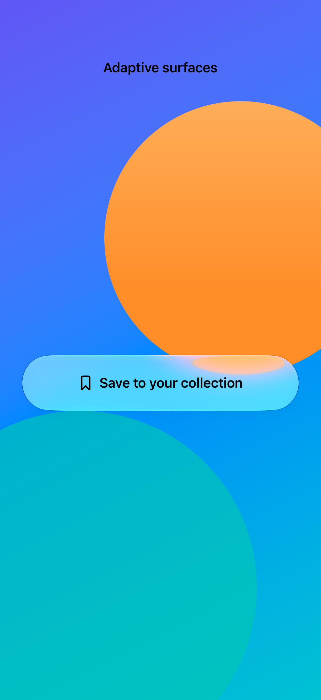
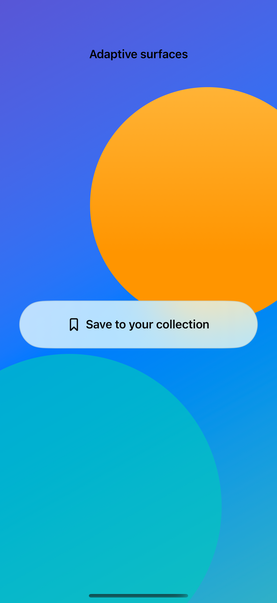
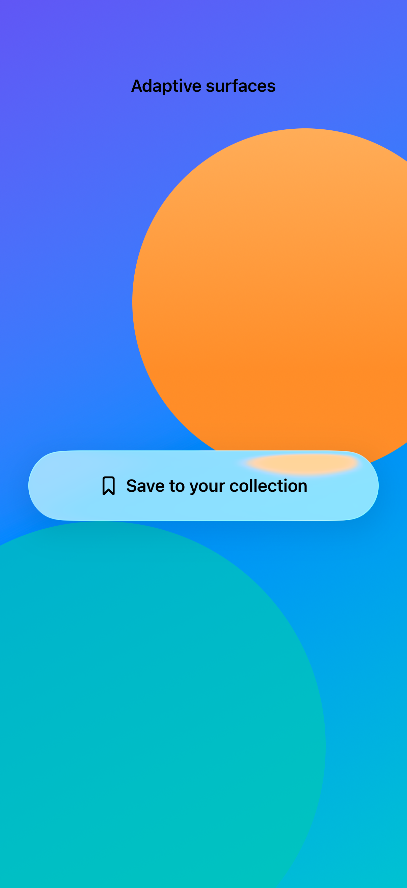

# Adaptive surfaces and fallbacks

A custom surface can use Liquid Glass on newer systems, a material on older systems, and an opaque treatment when Reduce Transparency is enabled.

## SwiftUI

```swift
import SwiftUI

struct AdaptiveSurface: View {
    @Environment(\.accessibilityReduceTransparency) private var opaque
    private var label: some View {
        Label("Saved places", systemImage: "bookmark").padding(24)
    }
    var body: some View {
        if opaque {
            label.background(Color(uiColor: .systemBackground), in: Capsule())
        } else if #available(iOS 26.0, *) {
            label.glassEffect()
        } else {
            label.background(.regularMaterial, in: Capsule())
        }
    }
}
```

## Captures

<!-- captures:start -->
### iPhone 18 Pro · iOS 27.0

default. light appearance; Large text; en_US.



### iPhone 16 Pro · iOS 18.5

default. light appearance; Large text; en_US.



### iPhone 17 Pro · iOS 26.5

default. light appearance; Large text; en_US.


<!-- captures:end -->

## Full example

[Open the complete runnable example](AdaptiveMaterialFallbackDemo.swift).

## Reference

[Apple: accessibilityReduceTransparency](https://developer.apple.com/documentation/swiftui/environmentvalues/accessibilityreducetransparency).
