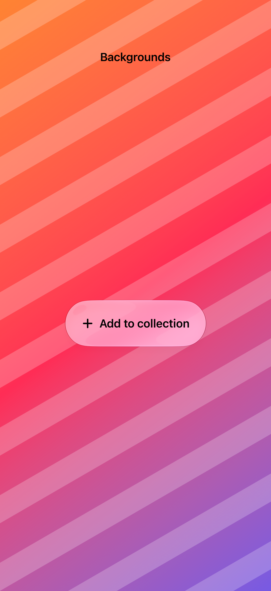

# Glass over different backgrounds

Glass responds to the content behind it, so its readability needs to be checked over both quiet and detailed backgrounds.

## SwiftUI

```swift
import SwiftUI

@available(iOS 26.0, *)
struct GlassOnColor: View {
    var body: some View {
        ZStack {
            LinearGradient(colors: [.orange, .pink, .indigo],
                           startPoint: .topLeading,
                           endPoint: .bottomTrailing)
            Button("Add to collection", systemImage: "plus") { }
                .padding(24).buttonStyle(.plain)
                .glassEffect(.regular.interactive())
        }
    }
}
```

## Captures

<!-- captures:start -->
### iPhone 18 Pro · iOS 27.0

default. light appearance; Large text; en_US.


<!-- captures:end -->

## Full example

[Open the complete runnable example](GlassBackgroundsDemo.swift).

## Reference

[Apple: glassEffect](https://developer.apple.com/documentation/swiftui/applying-liquid-glass-to-custom-views).
