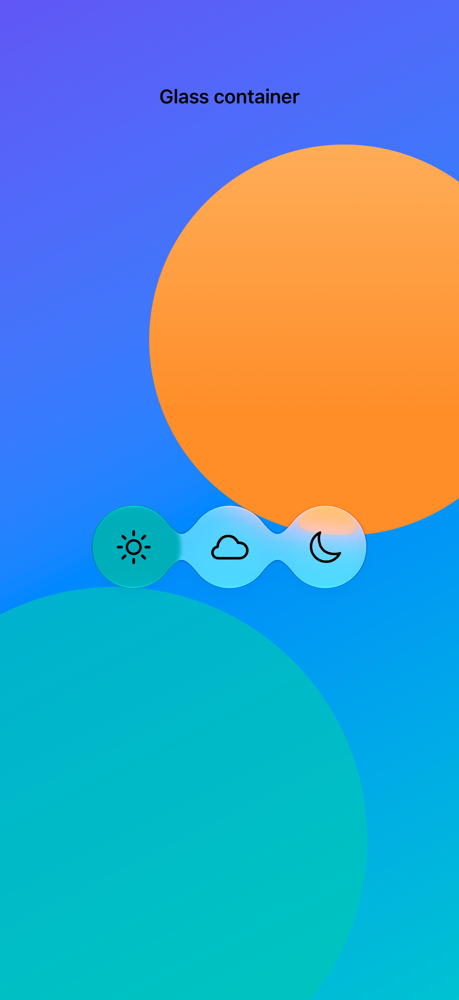

# Joining glass elements

A glass effect container lets nearby surfaces blend together; a shared union identifier combines selected effects into one shape.

## SwiftUI

```swift
import SwiftUI

@available(iOS 26.0, *)
struct JoinedGlass: View {
    @Namespace private var namespace
    var body: some View {
        GlassEffectContainer(spacing: 24) {
            HStack(spacing: 12) {
                ForEach(["sun.max", "moon"], id: \.self) { symbol in
                    Image(systemName: symbol).font(.title)
                        .frame(width: 64, height: 64)
                        .glassEffect(in: Circle())
                        .glassEffectUnion(id: "weather", namespace: namespace)
                }
            }
        }
    }
}
```

## Captures

<!-- captures:start -->
### iPhone 18 Pro · iOS 27.0

default. light appearance; Large text; en_US.


<!-- captures:end -->

## Full example

[Open the complete runnable example](GlassContainersDemo.swift).

## Reference

[Apple: GlassEffectContainer](https://developer.apple.com/documentation/swiftui/glasseffectcontainer).
