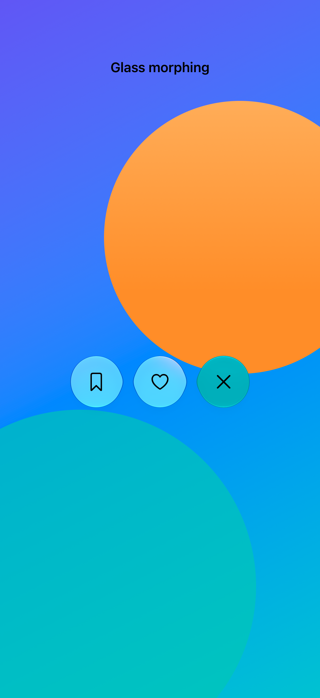
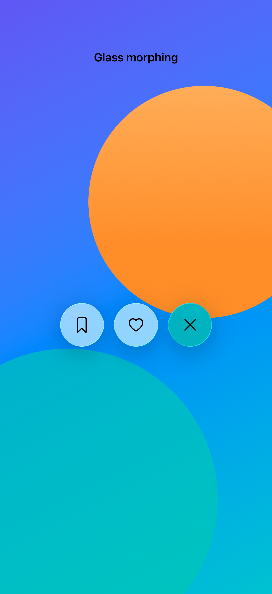

# Morphing glass controls

Stable glass effect identifiers let a container animate surfaces as controls appear, disappear, or change layout.

## SwiftUI

```swift
import SwiftUI

@available(iOS 26.0, *)
struct MorphingActions: View {
    @Namespace private var namespace
    @State private var expanded = false
    var body: some View {
        GlassEffectContainer(spacing: 24) {
            HStack(spacing: 16) {
                if expanded {
                    Image(systemName: "bookmark").padding(20)
                        .glassEffect().glassEffectID("save", in: namespace)
                }
                Button(expanded ? "Close" : "More") {
                    withAnimation(.spring()) { expanded.toggle() }
                }
                .padding(20).glassEffect(.regular.interactive())
                .glassEffectID("toggle", in: namespace)
            }
        }
    }
}
```

## Captures

<!-- captures:start -->
### iPhone 18 Pro · iOS 27.0

default. light appearance; Large text; en_US.



### iPhone 17 Pro · iOS 26.5

default. light appearance; Large text; en_US.


<!-- captures:end -->

## Full example

[Open the complete runnable example](GlassMorphingDemo.swift).

## Reference

[Apple: glassEffectID](https://developer.apple.com/documentation/swiftui/view/glasseffectid(_:in:)).
