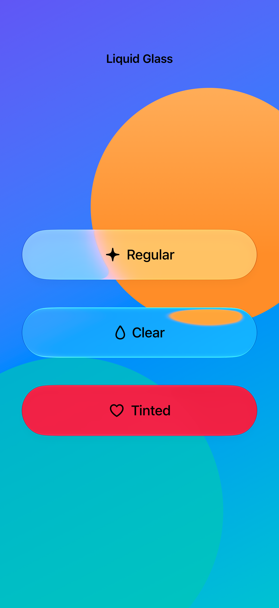
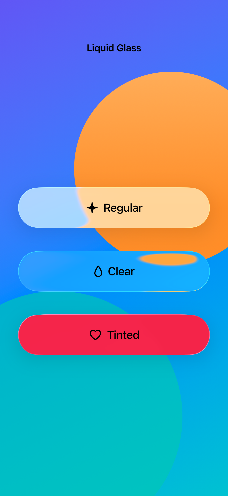

# Regular, clear, and tinted glass

Liquid Glass provides regular and clear treatments for custom controls, with optional tinting to give an action emphasis.

## SwiftUI

```swift
import SwiftUI

@available(iOS 26.0, *)
struct TintedGlassControl: View {
    @State private var saved = false
    var body: some View {
        Button { saved.toggle() } label: {
            Label(saved ? "Saved" : "Save", systemImage: "bookmark")
                .padding(.horizontal, 24).padding(.vertical, 16)
        }
        .buttonStyle(.plain)
        .glassEffect(.regular.tint(.teal).interactive(), in: Capsule())
    }
}
```

## Captures

<!-- captures:start -->
### iPhone 18 Pro · iOS 27.0

default. light appearance; Large text; en_US.



### iPhone 17 Pro · iOS 26.5

default. light appearance; Large text; en_US.


<!-- captures:end -->

## Full example

[Open the complete runnable example](GlassVariantsDemo.swift).

## Reference

[Apple: glassEffect](https://developer.apple.com/documentation/swiftui/glass).
