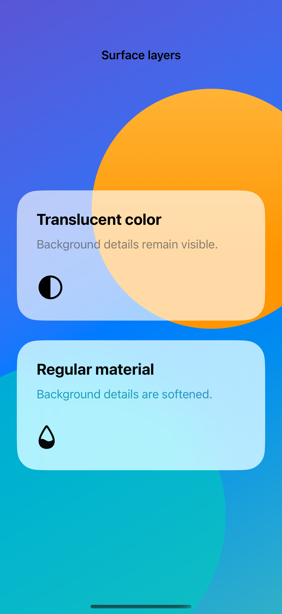
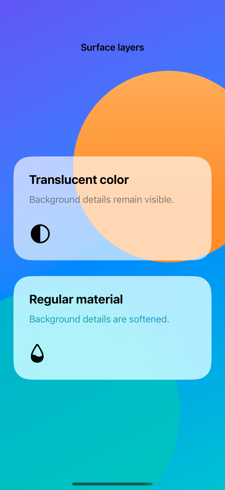

# Material and opacity

A translucent color lets the background show through directly; a material also changes the background’s detail and contrast.

## SwiftUI

```swift
import SwiftUI

struct TwoSurfaces: View {
    var body: some View {
        ZStack {
            LinearGradient(colors: [.orange, .indigo],
                           startPoint: .top, endPoint: .bottom)
            VStack(spacing: 24) {
                Text("Translucent color").padding(24)
                    .background(.white.opacity(0.65), in: Capsule())
                Text("Regular material").padding(24)
                    .background(.regularMaterial, in: Capsule())
            }
        }
    }
}
```

## Captures

<!-- captures:start -->
### iPhone 18 Pro · iOS 27.0

default. light appearance; Large text; en_US.


### iPhone 16 Pro · iOS 18.5

default. light appearance; Large text; en_US.



### iPhone 17 Pro · iOS 26.5

default. light appearance; Large text; en_US.


<!-- captures:end -->

## Full example

[Open the complete runnable example](MaterialVersusOpacityDemo.swift).

## Reference

[Apple: Material](https://developer.apple.com/documentation/swiftui/material).
