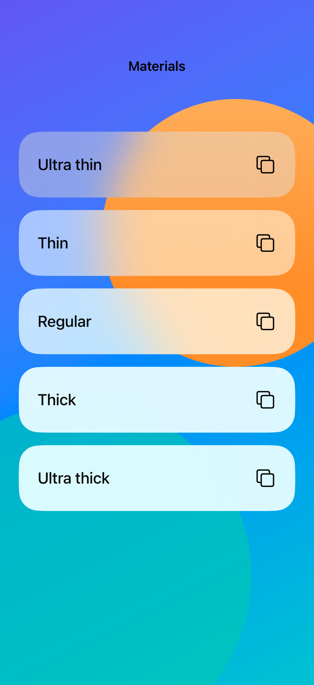

# System materials

System materials blend and blur the content behind a surface while adapting their appearance to the environment.

## SwiftUI

```swift
import SwiftUI

struct MaterialCard: View {
    var body: some View {
        ZStack {
            LinearGradient(colors: [.indigo, .teal],
                           startPoint: .top, endPoint: .bottom)
            Label("Saved places", systemImage: "bookmark")
                .font(.title2).padding(28)
                .background(.regularMaterial,
                            in: RoundedRectangle(cornerRadius: 24))
        }
    }
}
```

## Captures

<!-- captures:start -->
### iPhone 18 Pro · iOS 27.0

default. light appearance; Large text; en_US.


<!-- captures:end -->

## Full example

[Open the complete runnable example](SystemMaterialsDemo.swift).

## Reference

[Apple: Material](https://developer.apple.com/documentation/swiftui/material).
