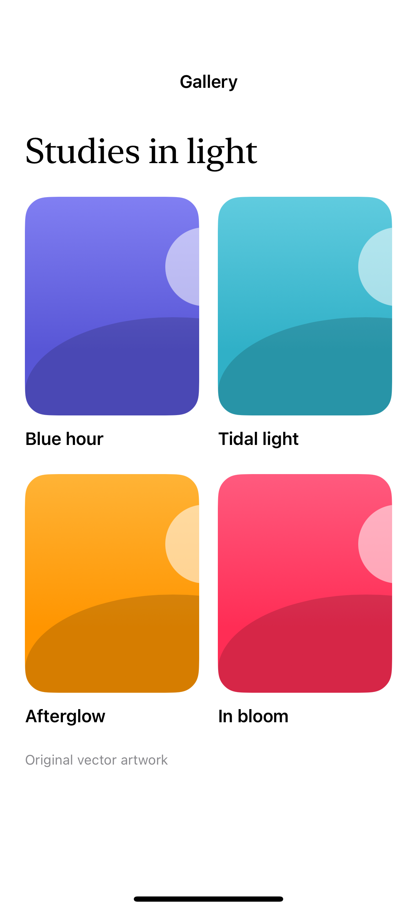

# A gallery with a zoom transition

A matched transition connects a gallery thumbnail to a full-screen viewer; the sample images here are original SwiftUI artwork.

## SwiftUI

```swift
import SwiftUI

struct ThumbnailZoom: View {
    @Namespace private var transition
    var body: some View {
        NavigationStack {
            NavigationLink {
                Rectangle().fill(.teal.gradient)
                    .navigationTransition(.zoom(sourceID: "art", in: transition))
            } label: {
                RoundedRectangle(cornerRadius: 20).fill(.teal.gradient)
                    .frame(width: 160, height: 200)
                    .matchedTransitionSource(id: "art", in: transition)
            }
        }
    }
}
```

## Captures

<!-- captures:start -->
### iPhone 16 Pro · iOS 18.5

default. light appearance; Large text; en_US.


<!-- captures:end -->

## Full example

[Open the complete runnable example](ArtworkGalleryTransitionDemo.swift).

## Reference

[Apple: matchedTransitionSource](https://developer.apple.com/documentation/swiftui/view/matchedtransitionsource(id:in:configuration:)).
