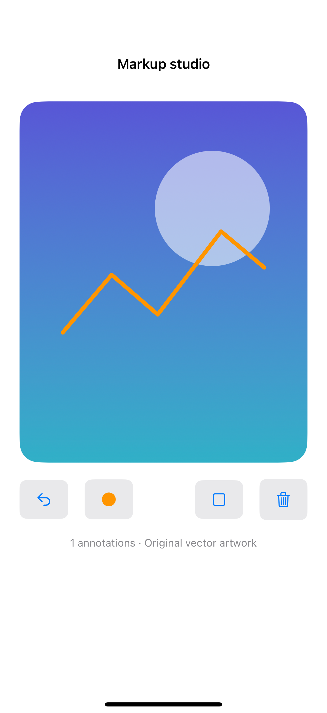

# Draw over an artwork

A Canvas renders normalized annotation strokes over original artwork; undo removes the latest stroke and resizing keeps its relative position.

## SwiftUI

```swift
import SwiftUI

struct DrawAStroke: View {
    @State private var strokes: [[CGPoint]] = []
    @State private var current: [CGPoint] = []
    @GestureState private var isDrawing = false
    var body: some View {
        Canvas { context, _ in
            for points in strokes + [current] {
                var path = Path()
                if let first = points.first {
                    path.move(to: first)
                    for point in points.dropFirst() { path.addLine(to: point) }
                }
                context.stroke(path, with: .color(.teal), style: StrokeStyle(lineWidth: 4, lineCap: .round))
            }
        }
        .background(.teal.opacity(0.08))
        .gesture(DragGesture(minimumDistance: 0)
            .updating($isDrawing) { _, active, _ in active = true }
            .onChanged { current.append($0.location) }
            .onEnded { _ in
                if !current.isEmpty { strokes.append(current) }
                current = []
            })
        .onChange(of: isDrawing) { _, active in if !active { current = [] } }
        .onChange(of: current.count) { _, count in
            if count > 0 && !isDrawing { current = [] }
        }
        .onDisappear { current = [] }
    }
}
```

## Captures

<!-- captures:start -->
### iPhone 16 Pro · iOS 18.5

default. light appearance; Large text; en_US.


<!-- captures:end -->

## Full example

[Open the complete runnable example](ArtworkMarkupToolsDemo.swift).

## Reference

[Apple: Canvas](https://developer.apple.com/documentation/swiftui/canvas).
