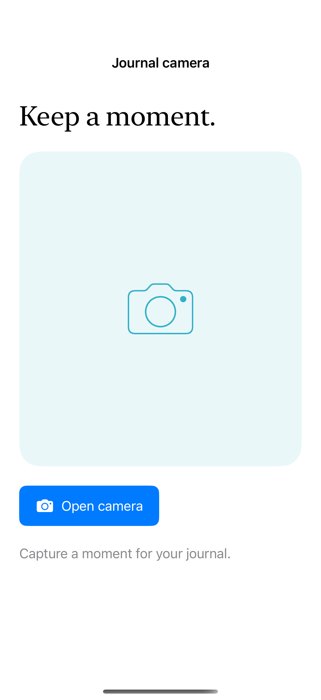

# A camera capture entry

The native camera requires a physical camera, authorization, and a usage description; unavailable hardware and denied access remain visible states.

## SwiftUI

```swift
import SwiftUI
import AVFoundation

struct CameraAvailability: View {
    @State private var message = "Camera idle"
    var body: some View {
        VStack {
            Button("Check camera access") {
                Task {
                    guard UIImagePickerController.isSourceTypeAvailable(.camera) else { message = "No camera available"; return }
                    guard Bundle.main.object(forInfoDictionaryKey: "NSCameraUsageDescription") is String else { message = "Camera access is not configured"; return }
                    let allowed = await AVCaptureDevice.requestAccess(for: .video)
                    message = allowed ? "Camera authorized" : "Camera unavailable"
                }
            }
            Text(message)
        }
    }
}
```

## Captures

<!-- captures:start -->
### iPhone 16 Pro · iOS 18.5

default. light appearance; Large text; en_US.


<!-- captures:end -->

## Full example

[Open the complete runnable example](CameraCaptureEntryDemo.swift).

## Reference

[Apple: UIImagePickerController](https://developer.apple.com/documentation/uikit/uiimagepickercontroller).
