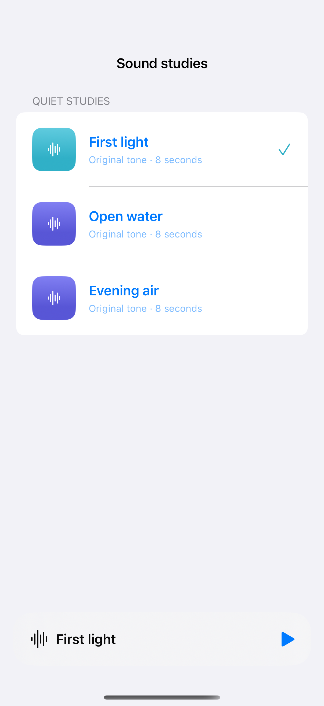

# An audio queue with a mini player

A compact player and expanded sheet share playback state; the three sample clips are quiet synthesized tones generated locally, with no recorded or licensed audio.

## SwiftUI

```swift
import SwiftUI
import AVFAudio

struct LocalAudioButton: View {
    let localURL: URL
    @State private var player: AVAudioPlayer?
    @State private var failed = false
    var body: some View {
        VStack {
            Button("Play", systemImage: "play.fill") {
                do {
                    player = try AVAudioPlayer(contentsOf: localURL)
                    failed = !(player?.play() ?? false)
                } catch { failed = true }
            }
            Button("Pause", systemImage: "pause.fill") { player?.pause() }
            if failed { Text("Audio could not be played.") }
        }.onDisappear { player?.stop() }
    }
}
```

## Captures

<!-- captures:start -->
### iPhone 16 Pro · iOS 18.5

default. light appearance; Large text; en_US.


<!-- captures:end -->

## Full example

[Open the complete runnable example](LocalAudioQueueDemo.swift).

## Reference

[Apple: AVAudioPlayer](https://developer.apple.com/documentation/avfaudio/avaudioplayer).
