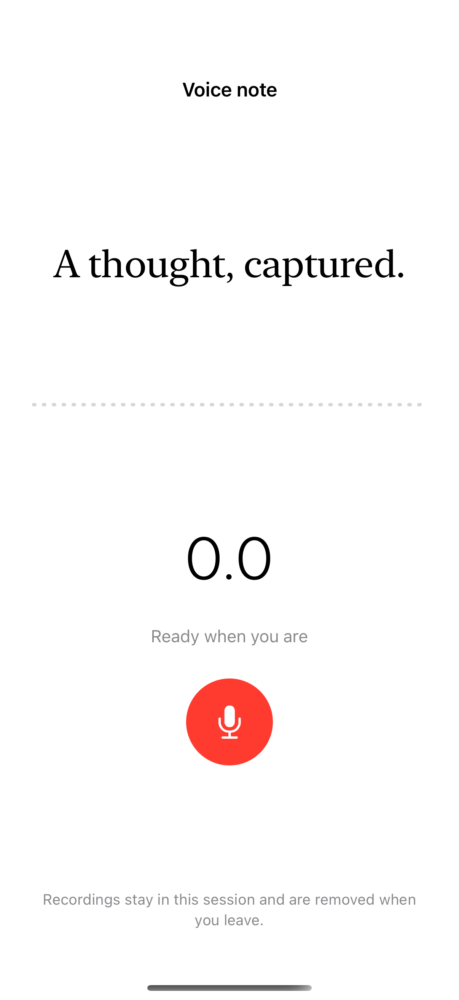

# Recording and microphone states

Recording starts only after a user action and microphone authorization; a configured microphone usage description and audio input are required.

## SwiftUI

```swift
import SwiftUI
import AVFAudio

struct RequestMicrophone: View {
    @State private var message = "Microphone idle"
    var body: some View {
        Button("Enable microphone") {
            Task {
                guard Bundle.main.object(forInfoDictionaryKey: "NSMicrophoneUsageDescription") is String else {
                    message = "Add a microphone usage description to this app."; return
                }
                let allowed = await AVAudioApplication.requestRecordPermission()
                message = allowed ? "Microphone authorized" : "Microphone unavailable"
            }
        }
        Text(message)
    }
}
```

## Captures

<!-- captures:start -->
### iPhone 16 Pro · iOS 18.5

default. light appearance; Large text; en_US.


<!-- captures:end -->

## Full example

[Open the complete runnable example](MicrophoneRecordingStateDemo.swift).

## Reference

[Apple: AVAudioRecorder](https://developer.apple.com/documentation/avfaudio/avaudiorecorder).
