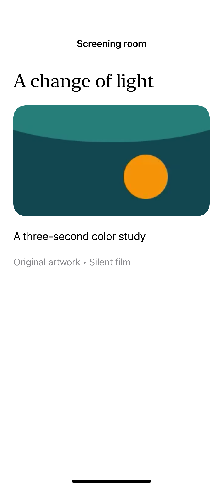

# Native video playback

AVPlayerViewController supplies native playback and full-screen controls; this example generates its own silent movie locally, without downloaded media.

## SwiftUI

```swift
import SwiftUI
import AVKit

struct NativeMovie: UIViewControllerRepresentable {
    let player: AVPlayer
    func makeUIViewController(context: Context) -> AVPlayerViewController {
        let controller = AVPlayerViewController()
        controller.player = player
        return controller
    }
    func updateUIViewController(_ controller: AVPlayerViewController, context: Context) {
        controller.player = player
    }
}
// Create AVPlayer(url: localMovieURL) and pass it to NativeMovie(player:).
```

## Captures

<!-- captures:start -->
### iPhone 16 Pro · iOS 18.5

default. light appearance; Large text; en_US.


<!-- captures:end -->

## Full example

[Open the complete runnable example](NativeVideoPlayerDemo.swift).

## Reference

[Apple: AVPlayerViewController](https://developer.apple.com/documentation/avkit/avplayerviewcontroller).
