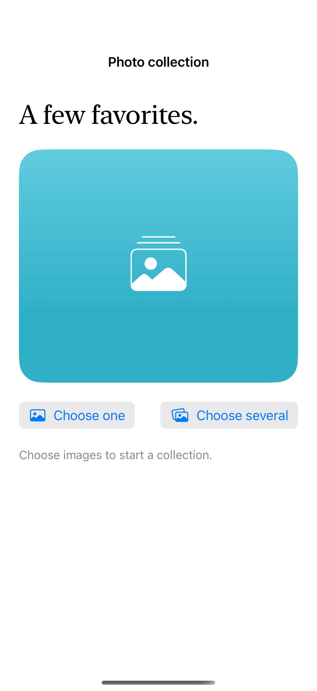

# System photo selection

PhotosPicker returns user-selected items without granting general library access; loading an item can still fail if its data is unavailable.

## SwiftUI

```swift
import SwiftUI
import PhotosUI

struct ChooseAnImage: View {
    @State private var selection: PhotosPickerItem?
    @State private var image: UIImage?
    @State private var failed = false
    var body: some View {
        VStack {
            if let image { Image(uiImage: image).resizable().scaledToFit() }
            PhotosPicker("Choose image", selection: $selection, matching: .images)
            if failed { Text("The image could not be loaded. Choose it again to retry.") }
        }
        .task(id: selection) {
            guard let selection else { return }
            do {
                let data = try await selection.loadTransferable(type: Data.self)
                guard !Task.isCancelled else { return }
                image = data.flatMap(UIImage.init(data:))
                failed = image == nil
            } catch { if !Task.isCancelled { failed = true } }
        }
    }
}
```

## Captures

<!-- captures:start -->
### iPhone 16 Pro · iOS 18.5

default. light appearance; Large text; en_US.


<!-- captures:end -->

## Full example

[Open the complete runnable example](SystemPhotoSelectionDemo.swift).

## Reference

[Apple: PhotosPicker](https://developer.apple.com/documentation/photokit/bringing-photos-picker-to-your-swiftui-app).
