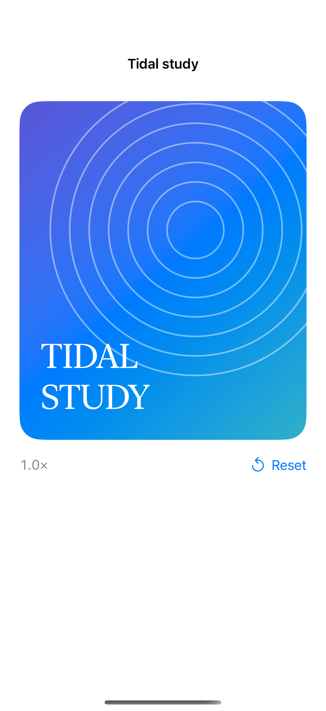

# Pinch, pan, and double-tap

A magnification gesture changes zoom, a drag pans the content, and a double-tap toggles a closer view; this example uses original vector artwork.

## SwiftUI

```swift
import SwiftUI

struct PinchToZoom: View {
    @State private var scale: CGFloat = 1
    @GestureState private var gestureScale: CGFloat = 1
    var body: some View {
        Image(systemName: "photo").resizable().scaledToFit()
            .scaleEffect(min(4, max(1, scale * gestureScale)))
            .gesture(MagnifyGesture()
                .updating($gestureScale) { value, state, _ in state = value.magnification }
                .onEnded { scale = min(4, max(1, scale * $0.magnification)) })
            .onTapGesture(count: 2) { scale = scale == 1 ? 2 : 1 }
    }
}
```

## Captures

<!-- captures:start -->
### iPhone 16 Pro · iOS 18.5

default. light appearance; Large text; en_US.


<!-- captures:end -->

## Full example

[Open the complete runnable example](ZoomPanArtworkDemo.swift).

## Reference

[Apple: MagnifyGesture](https://developer.apple.com/documentation/swiftui/magnifygesture).
