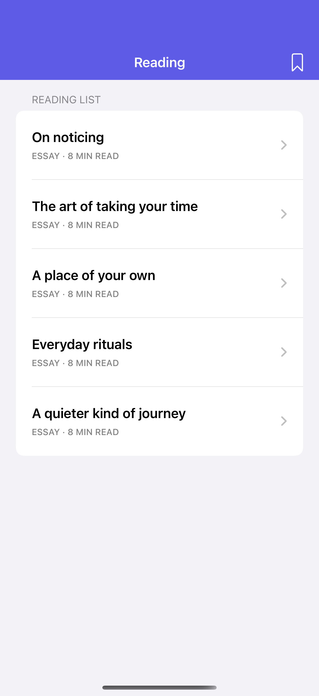
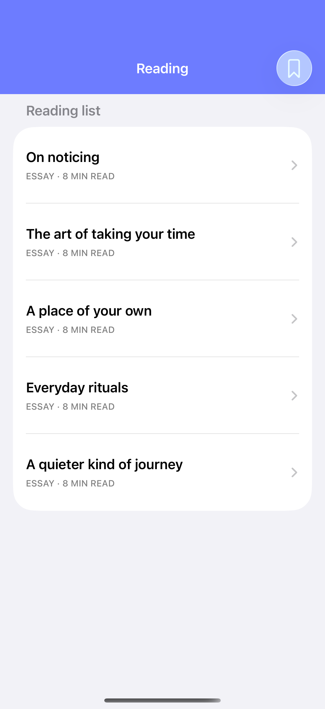

# Navigation bar appearance

Backgrounds, visibility, and color schemes change how content meets a navigation bar.

## SwiftUI

```swift
import SwiftUI

struct ColoredNavigationBar: View {
    var body: some View {
        NavigationStack {
            List(["On noticing", "Everyday rituals"], id: \.self) {
                Text($0)
            }
            .navigationTitle("Reading")
            .navigationBarTitleDisplayMode(.inline)
            .toolbarBackground(.indigo, for: .navigationBar)
            .toolbarBackground(.visible, for: .navigationBar)
            .toolbarColorScheme(.dark, for: .navigationBar)
        }
    }
}
```

## Captures

<!-- captures:start -->
### iPhone 16 Pro · iOS 18.5

default. light appearance; Large text; en_US.



### iPhone 17 Pro · iOS 26.5

default. light appearance; Large text; en_US.


<!-- captures:end -->

## Full example

[Open the complete runnable example](NavigationBarAppearanceDemo.swift).

## Reference

[Apple: toolbarBackground](https://developer.apple.com/documentation/swiftui/toolbars).
