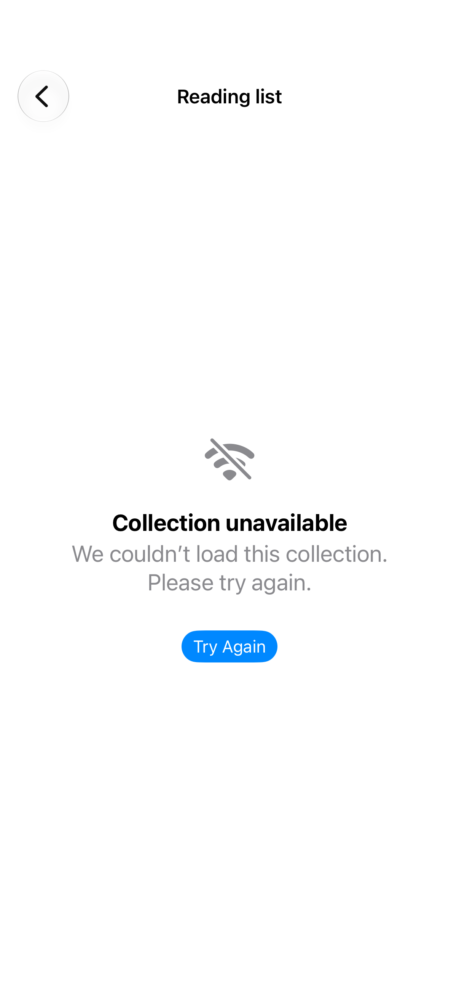

# Destination states

Loading and unavailable views keep navigation usable when a destination has no content.

## SwiftUI

```swift
import SwiftUI

struct UnavailableDestination: View {
    var body: some View {
        NavigationStack {
            List {
                NavigationLink("Open collection") {
                    ContentUnavailableView(
                        "Collection unavailable",
                        systemImage: "wifi.slash",
                        description: Text("Check your connection and try again.")
                    )
                    .navigationTitle("Collection")
                    .navigationBarTitleDisplayMode(.inline)
                }
            }
            .navigationTitle("Library")
        }
    }
}
```

## Captures

<!-- captures:start -->
### iPhone 18 Pro · iOS 27.0

default. light appearance; Large text; en_US.


<!-- captures:end -->

## Full example

[Open the complete runnable example](NavigationDestinationStatesDemo.swift).

## Reference

[Apple: ContentUnavailableView](https://developer.apple.com/documentation/swiftui/contentunavailableview).
