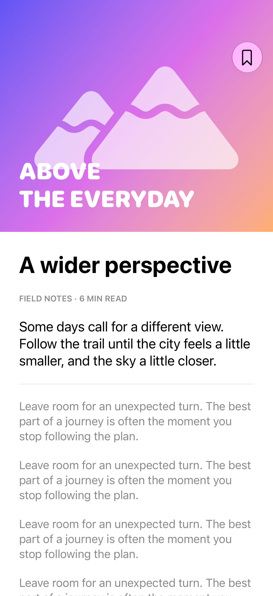

# Artwork beneath navigation

Full-bleed artwork can extend behind a transparent navigation bar.

## SwiftUI

```swift
import SwiftUI

struct ArtworkHeader: View {
    var body: some View {
        NavigationStack {
            ScrollView {
                VStack(spacing: 0) {
                    Image(systemName: "mountain.2.fill")
                        .font(.system(size: 140))
                        .frame(maxWidth: .infinity)
                        .frame(height: 340)
                        .foregroundStyle(.white)
                        .background(.indigo.gradient)
                    Text("A wider perspective").font(.largeTitle).padding()
                }
            }
            .ignoresSafeArea(edges: .top)
            .navigationBarTitleDisplayMode(.inline)
            .toolbarBackground(.hidden, for: .navigationBar)
        }
    }
}
```

## Captures

<!-- captures:start -->
### iPhone 18 Pro · iOS 27.0

default. light appearance; Large text; en_US.


<!-- captures:end -->

## Full example

[Open the complete runnable example](NavigationImageHeaderDemo.swift).

## Reference

[Apple: toolbarBackground](https://developer.apple.com/documentation/swiftui/view/toolbarbackground%28_%3Afor%3A%29-7lv0f).
