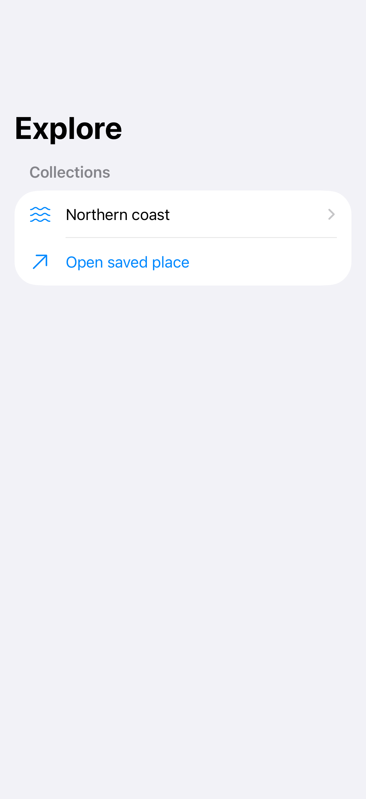
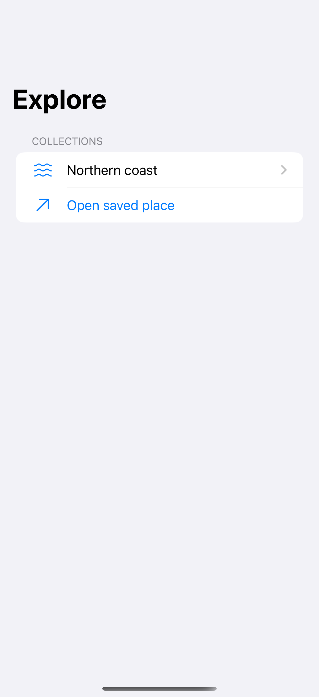
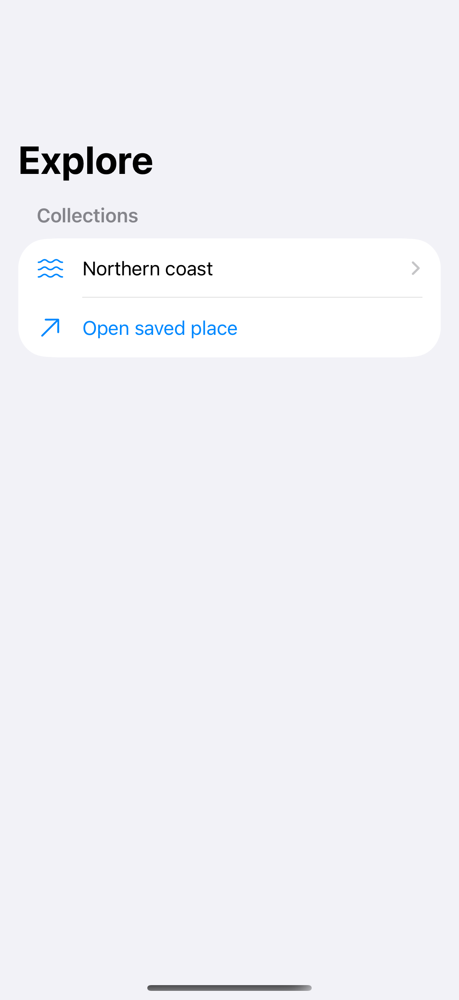

# Paths and restoration

A typed path makes deep links and navigation restoration explicit.

## SwiftUI

```swift
import SwiftUI

struct RestorableNavigation: View {
    @SceneStorage("savedPath") private var savedPath = ""
    @State private var path: [String] = []

    var body: some View {
        NavigationStack(path: $path) {
            Button("Open saved place") { path = ["Coast", "Point Reyes"] }
                .navigationDestination(for: String.self) { Text($0) }
        }
        .task {
            if let data = savedPath.data(using: .utf8) {
                path = (try? JSONDecoder().decode([String].self, from: data)) ?? []
            }
        }
        .onChange(of: path) { _, value in
            if let data = try? JSONEncoder().encode(value) {
                savedPath = String(decoding: data, as: UTF8.self)
            }
        }
    }
}
```

## Captures

<!-- captures:start -->
### iPhone 18 Pro · iOS 27.0

default. light appearance; Large text; en_US.



### iPhone 16 Pro · iOS 18.5

default. light appearance; Large text; en_US.



### iPhone 17 Pro · iOS 26.5

default. light appearance; Large text; en_US.


<!-- captures:end -->

## Full example

[Open the complete runnable example](NavigationPathRestorationDemo.swift).

## Reference

[Apple: NavigationStack](https://developer.apple.com/documentation/swiftui/navigationstack).
