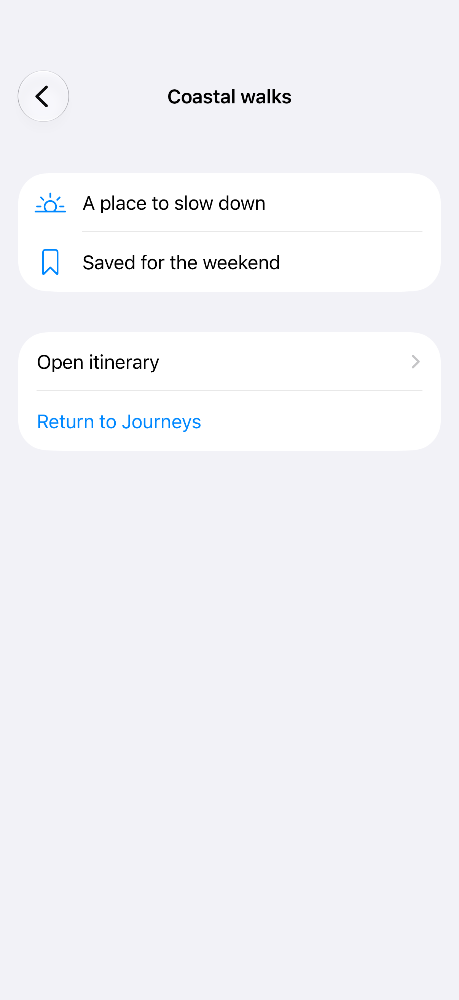
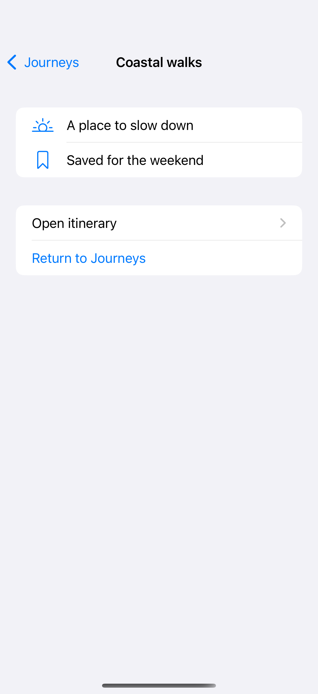
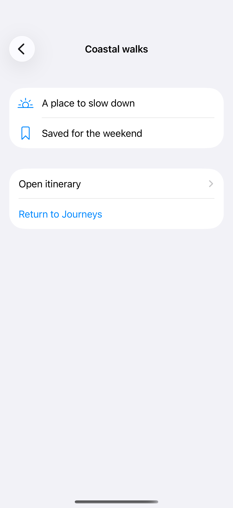

# Push and pop

A stack of destinations with a native back button.

## SwiftUI

```swift
import SwiftUI

struct JourneyNavigation: View {
    var body: some View {
        NavigationStack {
            List {
                NavigationLink("Coastal walks", value: "Coastal walks")
            }
            .navigationTitle("Journeys")
            .navigationDestination(for: String.self) { title in
                Text(title)
                    .navigationTitle(title)
                    .navigationBarTitleDisplayMode(.inline)
            }
        }
    }
}
```

## Captures

<!-- captures:start -->
### iPhone 18 Pro · iOS 27.0

default. light appearance; Large text; en_US.



### iPhone 16 Pro · iOS 18.5

default. light appearance; Large text; en_US.



### iPhone 17 Pro · iOS 26.5

default. light appearance; Large text; en_US.


<!-- captures:end -->

## Full example

[Open the complete runnable example](NavigationPushPopDemo.swift).

## Reference

[Apple: NavigationStack](https://developer.apple.com/documentation/swiftui/navigationstack).
