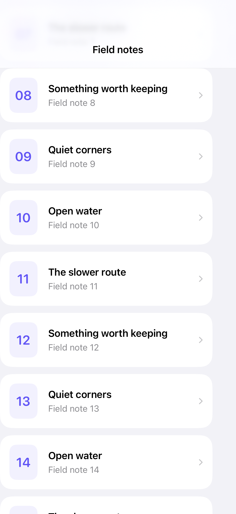

# Returning to a scroll position

Keeping scroll state in the root view preserves a place when a detail screen closes.

## SwiftUI

```swift
import SwiftUI

struct RememberedScrollPosition: View {
    @State private var position: Int?

    var body: some View {
        NavigationStack {
            ScrollView {
                LazyVStack {
                    ForEach(1...100, id: \.self) { id in
                        NavigationLink("Note \(id)", value: id).id(id)
                    }
                }
                .scrollTargetLayout()
            }
            .scrollPosition(id: $position)
            .navigationDestination(for: Int.self) { id in
                Text("Note \(id)")
            }
        }
    }
}
```

## Captures

<!-- captures:start -->
### iPhone 18 Pro · iOS 27.0

default. light appearance; Large text; en_US.


<!-- captures:end -->

## Full example

[Open the complete runnable example](NavigationScrollRestorationDemo.swift).

## Reference

[Apple: scrollPosition](https://developer.apple.com/documentation/swiftui/view/scrollposition(id:anchor:)).
