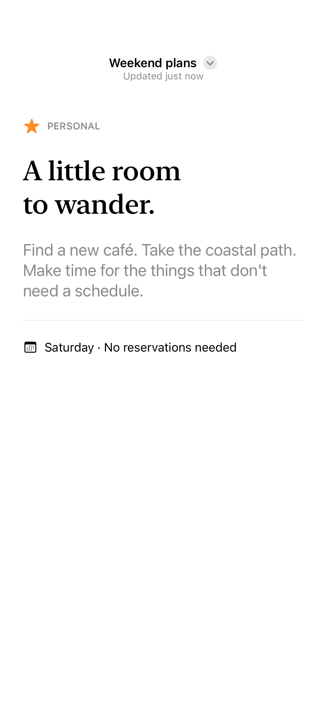
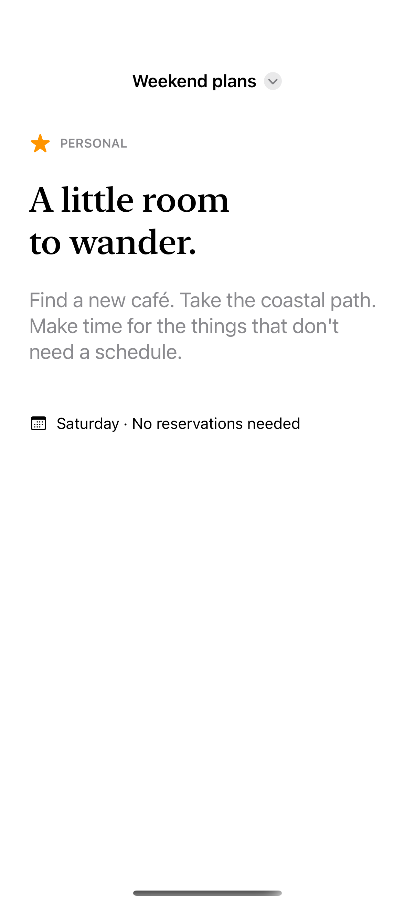
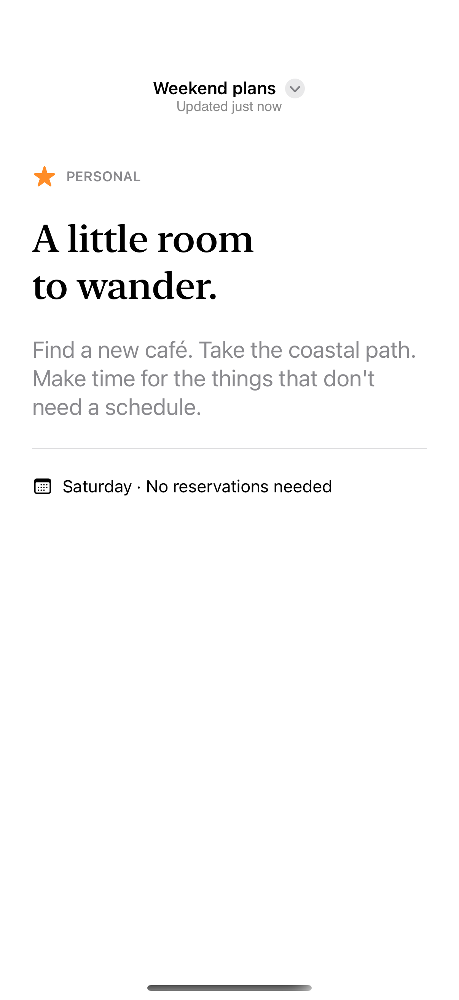

# Title menus and subtitles

A title menu keeps document actions next to the document name.

## SwiftUI

```swift
import SwiftUI

struct DocumentTitleMenu: View {
    @State private var title = "Weekend plans"
    @State private var favorite = false

    var body: some View {
        NavigationStack {
            Text("A little room to wander.")
                .navigationTitle($title)
                .navigationBarTitleDisplayMode(.inline)
                .toolbarTitleMenu {
                    Button(favorite ? "Unfavorite" : "Favorite",
                           systemImage: "star") {
                        favorite.toggle()
                    }
                }
        }
    }
}
```

The complete example adds the native subtitle on iOS 26 and later.

## Captures

<!-- captures:start -->
### iPhone 18 Pro · iOS 27.0

default. light appearance; Large text; en_US.



### iPhone 16 Pro · iOS 18.5

default. light appearance; Large text; en_US.



### iPhone 17 Pro · iOS 26.5

default. light appearance; Large text; en_US.


<!-- captures:end -->

## Full example

[Open the complete runnable example](NavigationTitleMenuDemo.swift).

## Reference

[Apple: toolbarTitleMenu](https://developer.apple.com/documentation/swiftui/view/toolbartitlemenu(content:)).
