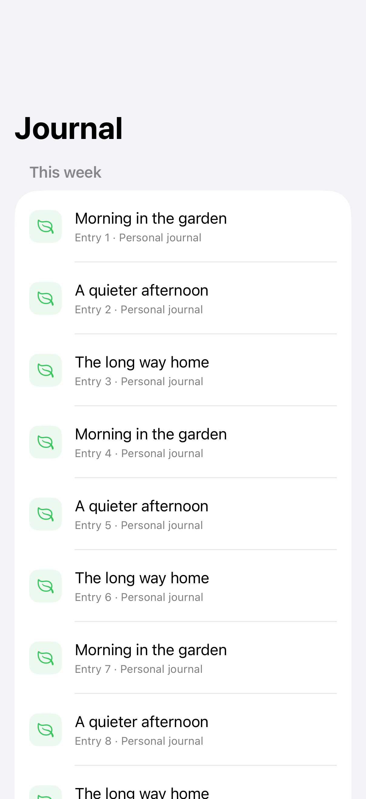
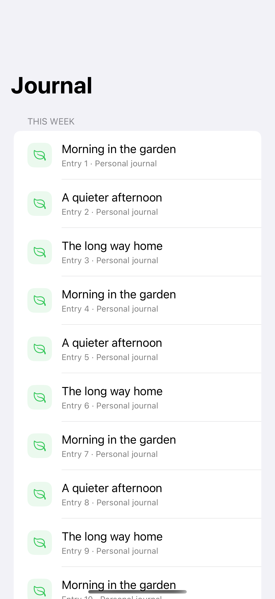
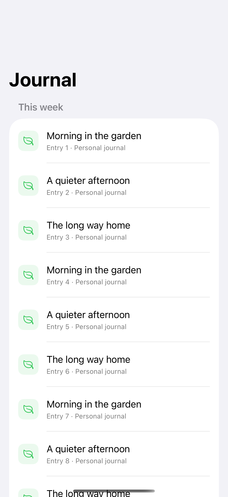

# Navigation titles

Large and inline titles establish the hierarchy of a destination.

## SwiftUI

```swift
import SwiftUI

struct JournalTitles: View {
    var body: some View {
        NavigationStack {
            List(1...30, id: \.self) { index in
                NavigationLink("Journal entry \(index)") {
                    Text("A quieter afternoon.")
                        .navigationTitle("Entry \(index)")
                        .navigationBarTitleDisplayMode(.inline)
                }
            }
            .navigationTitle("Journal")
            .navigationBarTitleDisplayMode(.large)
        }
    }
}
```

## Captures

<!-- captures:start -->
### iPhone 18 Pro · iOS 27.0

default. light appearance; Large text; en_US.



### iPhone 16 Pro · iOS 18.5

default. light appearance; Large text; en_US.



### iPhone 17 Pro · iOS 26.5

default. light appearance; Large text; en_US.


<!-- captures:end -->

## Full example

[Open the complete runnable example](NavigationTitleStylesDemo.swift).

## Reference

[Apple: navigationTitle](https://developer.apple.com/documentation/swiftui/view/navigationbartitledisplaymode(_:)).
