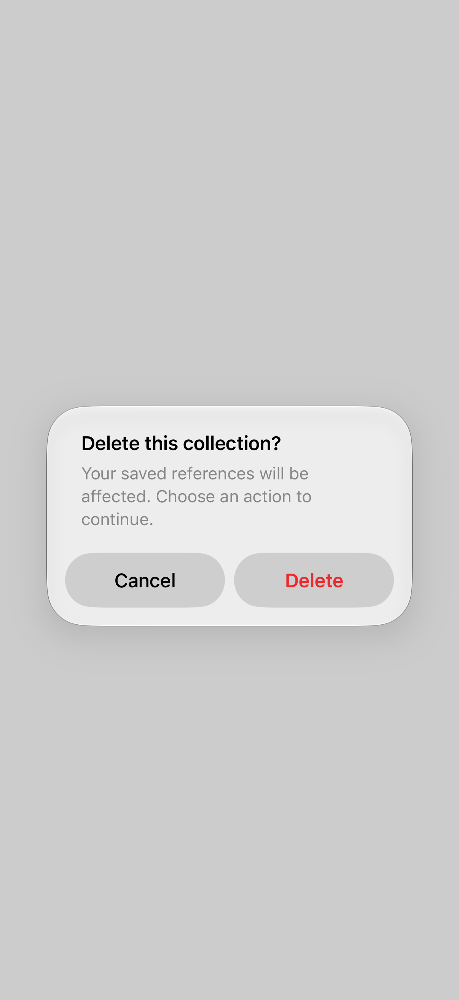

# Alert actions

An alert interrupts the current task to ask for a decision or show important information.

## SwiftUI

```swift
import SwiftUI

struct DeleteAlert: View {
    @State private var isPresented = false

    var body: some View {
        Button("Delete collection") { isPresented = true }
            .alert("Delete this collection?",
                   isPresented: $isPresented) {
                Button("Delete", role: .destructive) {
                    // Delete the collection here.
                }
                Button("Cancel", role: .cancel) { }
            } message: {
                Text("Your saved references will be removed.")
            }
    }
}
```

## Captures

<!-- captures:start -->
### iPhone 18 Pro · iOS 27.0

Two actions; destructive primary; isolated presentation. light appearance; Large text; en_US.


<!-- captures:end -->

## Full example

[Open the complete runnable example](AlertActionsDemo.swift).

## Reference

[Apple: alerts](https://developer.apple.com/design/human-interface-guidelines/alerts).
