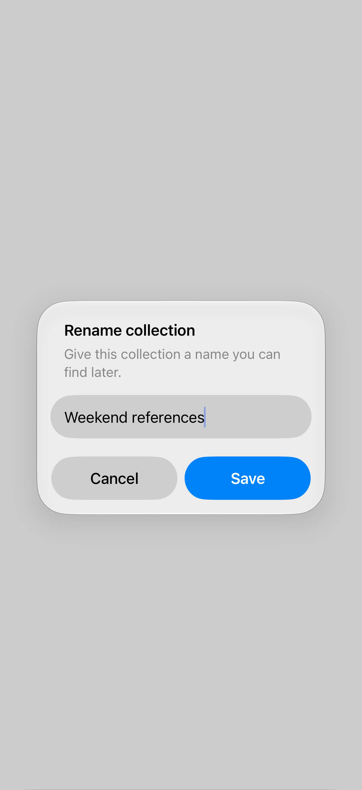
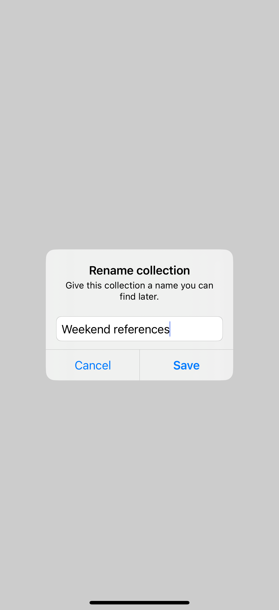
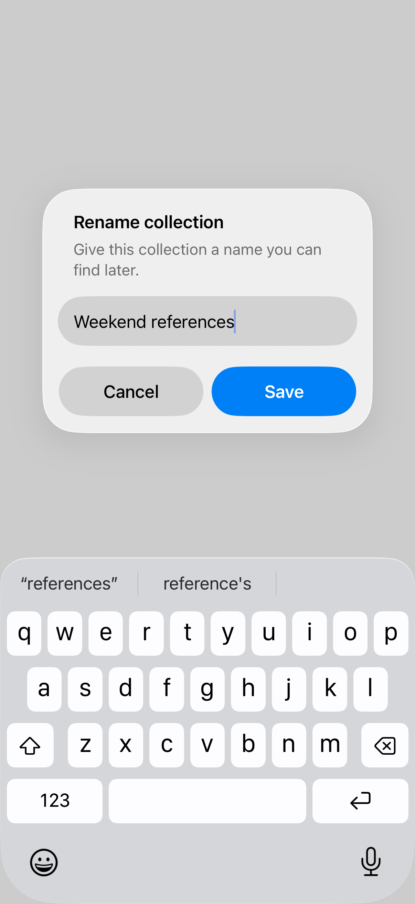

# Alert text fields

An alert can include a text field for a small, focused edit, such as renaming an item.

## SwiftUI

```swift
import SwiftUI

struct RenameAlert: View {
    @State private var isPresented = false
    @State private var name = "Weekend references"
    @State private var draft = ""

    var body: some View {
        Button("Rename collection") {
            draft = name
            isPresented = true
        }
        .alert("Rename collection",
               isPresented: $isPresented) {
            TextField("Collection name", text: $draft)
            Button("Save") {
                name = draft.trimmingCharacters(
                    in: .whitespacesAndNewlines
                )
            }
            .disabled(draft.trimmingCharacters(
                in: .whitespacesAndNewlines
            ).isEmpty)
            Button("Cancel", role: .cancel) { }
        }
    }
}
```

## Captures

<!-- captures:start -->
### iPhone 18 Pro · iOS 27.0

Rename alert; isolated presentation; software keyboard hidden. light appearance; Large text; en_US.



### iPhone 16 Pro · iOS 18.5

Rename alert; isolated presentation; software keyboard hidden. light appearance; Large text; en_US.



### iPhone 17 Pro · iOS 26.5

Rename alert; isolated presentation; software keyboard hidden. light appearance; Large text; en_US.


<!-- captures:end -->

## Full example

[Open the complete runnable example](AlertTextFieldsDemo.swift).

## Reference

[Apple: alerts](https://developer.apple.com/design/human-interface-guidelines/alerts).
