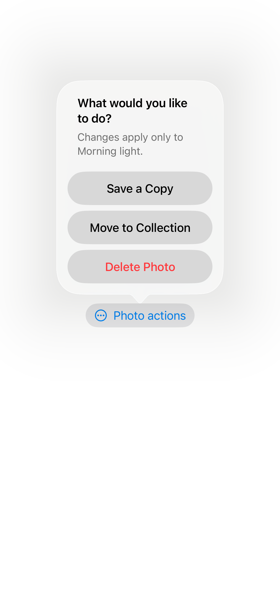
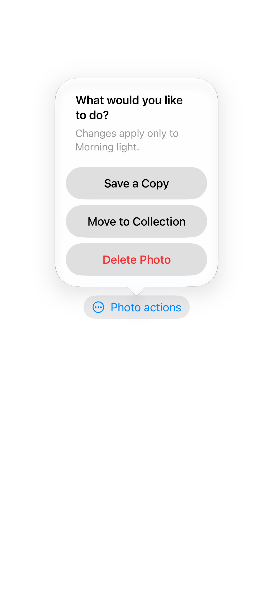

# Confirmation dialogs

A confirmation dialog offers actions for a selected item, separating destructive choices from cancellation.

## SwiftUI

```swift
import SwiftUI

struct PhotoActions: View {
    @State private var showing = false
    var body: some View {
        Button("Photo actions") { showing = true }
            .confirmationDialog("Choose an action",
                                isPresented: $showing,
                                titleVisibility: .visible) {
                Button("Save a Copy") { /* Save the copy. */ }
                Button("Delete", role: .destructive) { /* Delete. */ }
                Button("Cancel", role: .cancel) { }
            }
    }
}
```

## Captures

<!-- captures:start -->
### iPhone 16 Pro · iOS 18.5

default. light appearance; Large text; en_US.


### iPhone 17 Pro · iOS 26.5

default. light appearance; Large text; en_US.



### iPhone 18 Pro · iOS 27.0

default. light appearance; Large text; en_US.


<!-- captures:end -->

## Full example

[Open the complete runnable example](ConfirmationDialogsDemo.swift).
