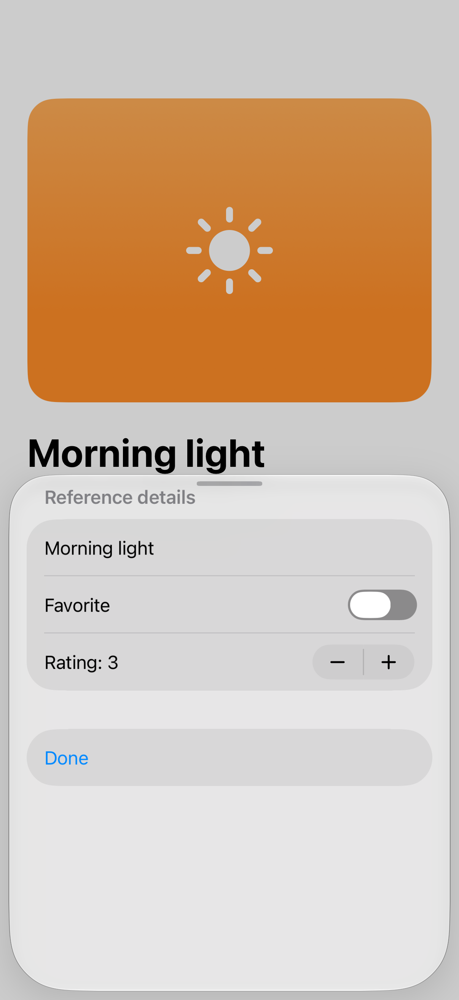
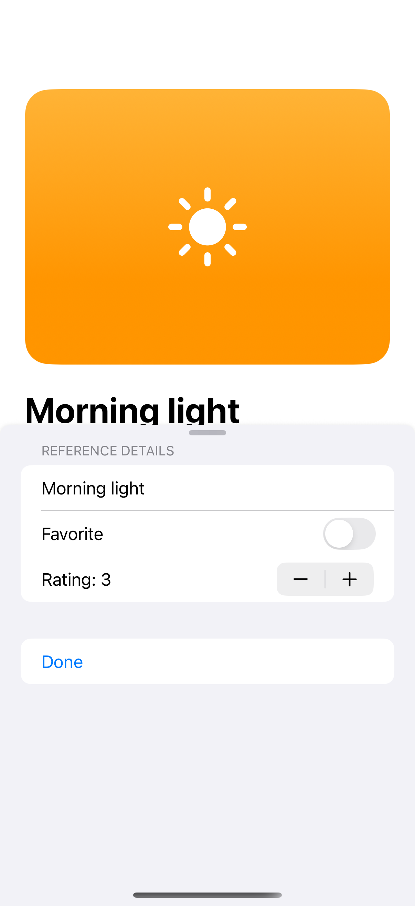
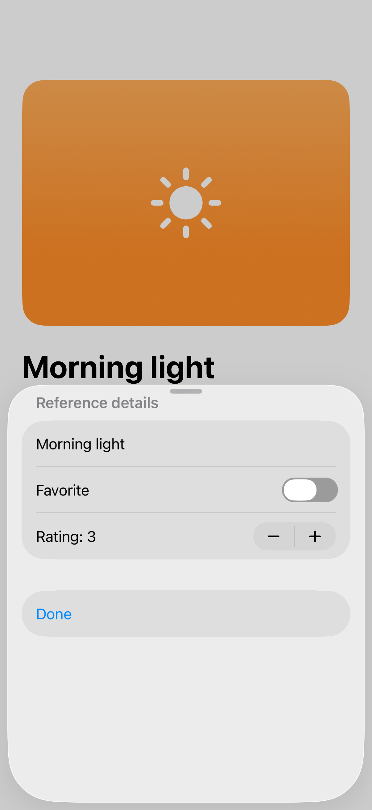

# Adaptive inspectors

An inspector shows properties of the selected content, adapting from a trailing column to a sheet when space is limited.

## SwiftUI

```swift
import SwiftUI

struct DocumentInspector: View {
    @State private var showing = false
    @State private var title = "Morning light"
    var body: some View {
        Button("Inspect document") { showing = true }
            .inspector(isPresented: $showing) {
                Form { TextField("Title", text: $title) }
                    .inspectorColumnWidth(min: 280, ideal: 320, max: 400)
                    .presentationDetents([.medium, .large])
            }
    }
}
```

## Captures

<!-- captures:start -->
### iPhone 18 Pro · iOS 27.0

default. light appearance; Large text; en_US.



### iPhone 16 Pro · iOS 18.5

default. light appearance; Large text; en_US.



### iPhone 17 Pro · iOS 26.5

default. light appearance; Large text; en_US.


<!-- captures:end -->

## Full example

[Open the complete runnable example](InspectorsDemo.swift).
