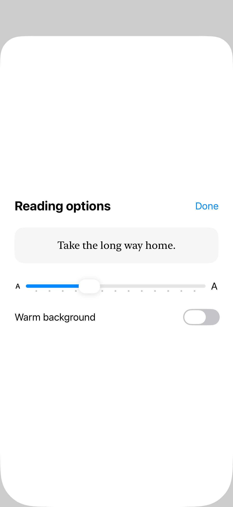

# Popover adaptation

A popover can adapt to a sheet in compact layouts, or request an anchored presentation with presentationCompactAdaptation.

## SwiftUI

```swift
import SwiftUI

struct ReadingPopover: View {
    @State private var showing = false
    var body: some View {
        Button("Reading options") { showing = true }
            .popover(isPresented: $showing) {
                Text("Reading options")
                    .padding(24)
                    .presentationCompactAdaptation(.popover)
            }
    }
}
```

## Captures

<!-- captures:start -->
### iPhone 18 Pro · iOS 27.0

default. light appearance; Large text; en_US.


<!-- captures:end -->

## Full example

[Open the complete runnable example](PopoverAdaptationDemo.swift).
