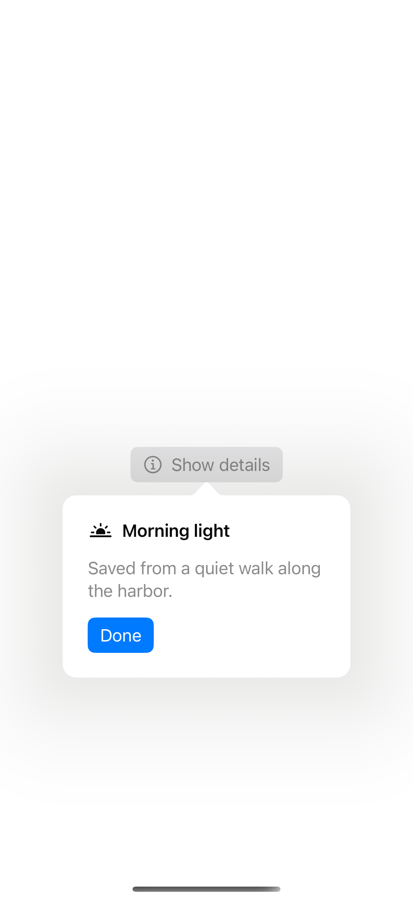
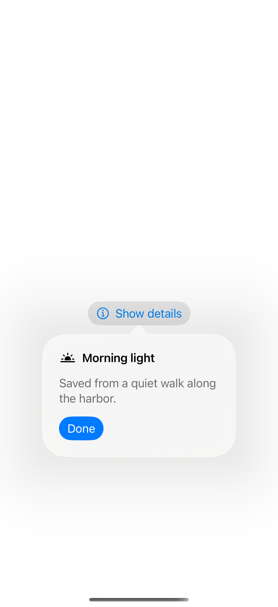

# Popover anchors

A popover attaches a small surface to its source control; the system uses the anchor, requested arrow edge, and available space to place it.

## SwiftUI

```swift
import SwiftUI

struct AnchoredPopover: View {
    @State private var showing = false
    var body: some View {
        Button("Details", systemImage: "info.circle") { showing = true }
            .popover(isPresented: $showing,
                     attachmentAnchor: .rect(.bounds),
                     arrowEdge: .top) {
                Text("A little more context.")
                    .padding(24)
                    .frame(width: 280)
                    .presentationCompactAdaptation(.popover)
            }
    }
}
```

## Captures

<!-- captures:start -->
### iPhone 18 Pro · iOS 27.0

default. light appearance; Large text; en_US.


### iPhone 16 Pro · iOS 18.5

default. light appearance; Large text; en_US.



### iPhone 17 Pro · iOS 26.5

default. light appearance; Large text; en_US.


<!-- captures:end -->

## Full example

[Open the complete runnable example](PopoverAnchorsDemo.swift).
