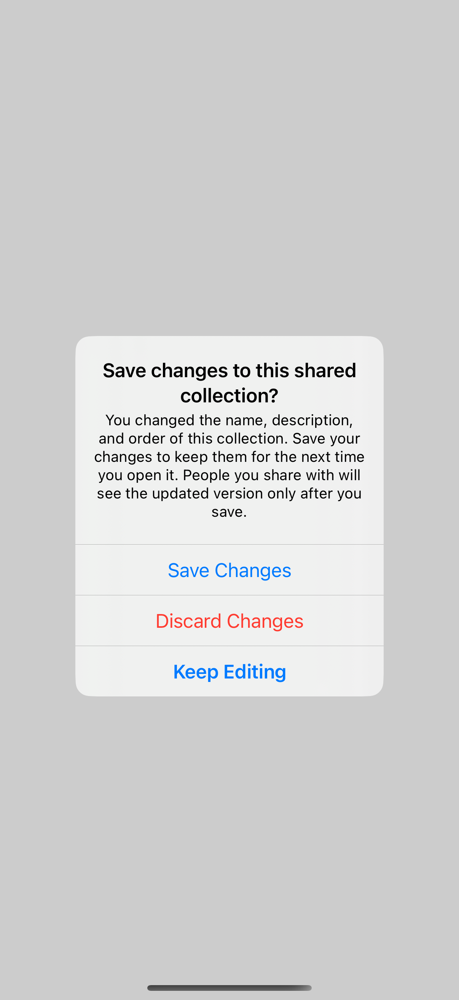
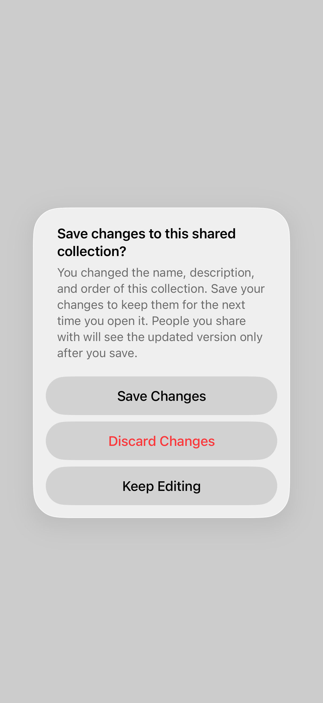
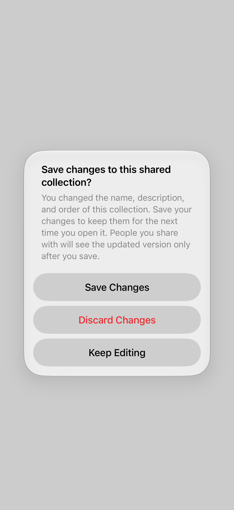

# Long text & accessibility

Long messages and translated action labels reveal how alerts reflow as content and text size change.

## SwiftUI

```swift
import SwiftUI

struct LongMessageAlert: View {
    @State private var showing = false
    var body: some View {
        Button("Review changes") { showing = true }
            .alert("Save changes to this shared collection?",
                   isPresented: $showing) {
                Button("Save Changes") { /* Save. */ }
                Button("Discard Changes", role: .destructive) { /* Discard. */ }
                Button("Keep Editing", role: .cancel) { }
            } message: {
                Text("You changed the name, description, and order. "
                     + "Save to keep your changes for the next time you open it.")
            }
    }
}
```

## Captures

<!-- captures:start -->
### iPhone 16 Pro · iOS 18.5

default. light appearance; Large text; en_US.



### iPhone 17 Pro · iOS 26.5

default. light appearance; Large text; en_US.



### iPhone 18 Pro · iOS 27.0

default. light appearance; Large text; en_US.


<!-- captures:end -->

## Full example

[Open the complete runnable example](PresentationStressTestsDemo.swift).
