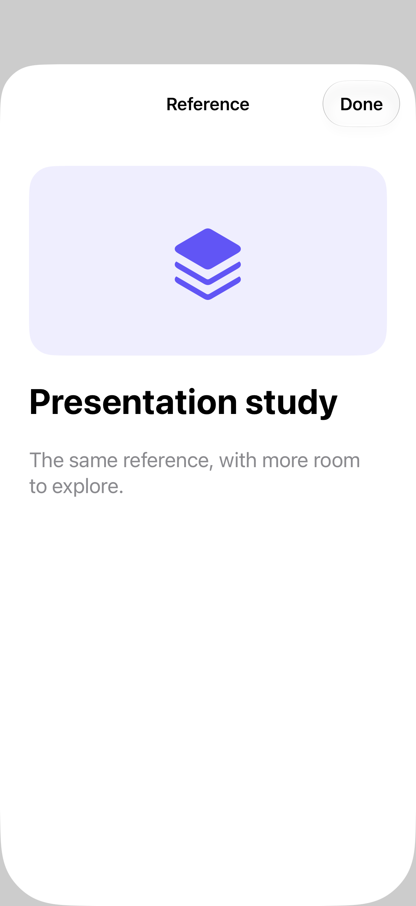

# Source-linked transitions

A source-linked zoom connects a presented destination to the view that opened it; run the example to see the motion.

## SwiftUI

```swift
import SwiftUI

struct ZoomPresentation: View {
    @Namespace private var transition
    @State private var showing = false
    var body: some View {
        Button("Open reference") { showing = true }
            .matchedTransitionSource(id: "reference", in: transition)
            .sheet(isPresented: $showing) {
                Text("Presentation study")
                    .navigationTransition(
                        .zoom(sourceID: "reference", in: transition)
                    )
            }
    }
}
```

## Captures

<!-- captures:start -->
### iPhone 18 Pro · iOS 27.0

default. light appearance; Large text; en_US.


<!-- captures:end -->

## Full example

[Open the complete runnable example](SourceTransitionsDemo.swift).
