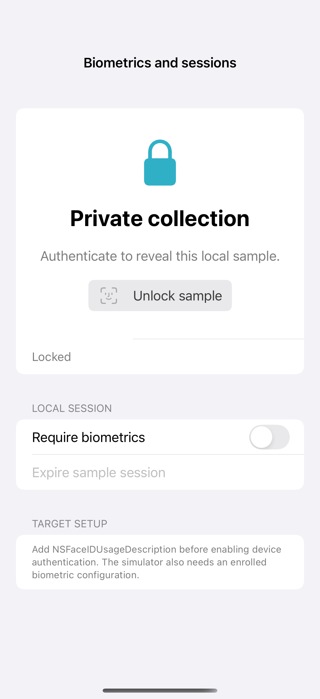

# Biometrics and reauthentication

LocalAuthentication presents the real device authentication interface and reports success, unavailability, cancellation, or failure. This sample gates access to a local card, can expire that local session, and invalidates interrupted requests. Face ID requires NSFaceIDUsageDescription; no authentication runs automatically or during capture.

## SwiftUI

```swift
import SwiftUI
import LocalAuthentication

struct BiometricRecipe: View {
    @State private var status = "Locked"
    var body: some View {
        VStack(spacing: 20) {
            Text(status)
            Button("Unlock sample") {
                guard !(Bundle.main.object(forInfoDictionaryKey: "NSFaceIDUsageDescription") as? String ?? "").isEmpty else {
                    status = "Add NSFaceIDUsageDescription to the app target"; return
                }
                Task {
                    let context = LAContext()
                    var error: NSError?
                    guard context.canEvaluatePolicy(.deviceOwnerAuthentication, error: &error) else { status = "Device authentication unavailable"; return }
                    do { status = try await context.evaluatePolicy(.deviceOwnerAuthentication, localizedReason: "Reveal the local sample.") ? "Unlocked" : "Not authenticated" }
                    catch { status = "Authentication cancelled or failed" }
                }
            }
        }.padding()
    }
}
```

## Captures

<!-- captures:start -->
### iPhone 16 Pro · iOS 18.5

default. light appearance; Large text; en_US.


<!-- captures:end -->

## Full example

[Open the complete runnable example](BiometricsReauthenticationDemo.swift).

## Reference

[Apple: LocalAuthentication](https://developer.apple.com/documentation/localauthentication).
