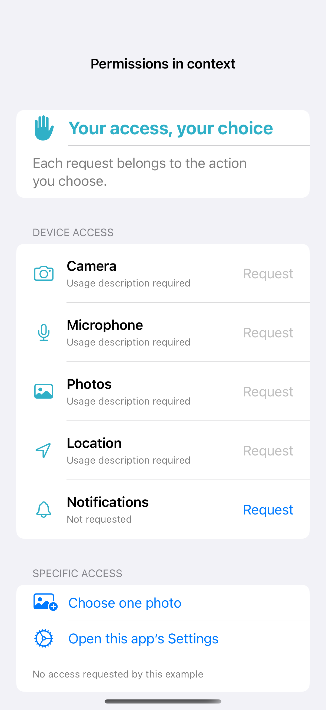

# Permissions in context

Permission requests should follow an action that needs the protected capability. This screen reads real access states, distinguishes denied, restricted, and limited access, and offers Settings recovery; request buttons check required usage descriptions first. The photo picker can select an item without broad library permission, and the example never reads its pixels, requests a location, records media, or schedules notifications.

## SwiftUI

```swift
import SwiftUI
import UserNotifications

struct NotificationPermissionRecipe: View {
    @State private var status = "Not requested by this example"
    var body: some View {
        VStack(spacing: 20) {
            Label("Reminders for saved plans", systemImage: "bell")
            Button("Allow notifications") {
                Task {
                    do {
                        let allowed = try await UNUserNotificationCenter.current().requestAuthorization(options: [.alert, .badge, .sound])
                        status = allowed ? "Allowed" : "Not allowed; review access in Settings"
                    } catch { status = "Request failed" }
                }
            }
            Text(status).font(.caption)
        }.padding()
    }
}
```

## Captures

<!-- captures:start -->
### iPhone 16 Pro · iOS 18.5

default. light appearance; Large text; en_US.


<!-- captures:end -->

## Full example

[Open the complete runnable example](ContextualPermissionsDemo.swift).

## Reference

[Apple: Privacy](https://developer.apple.com/design/human-interface-guidelines/privacy).
