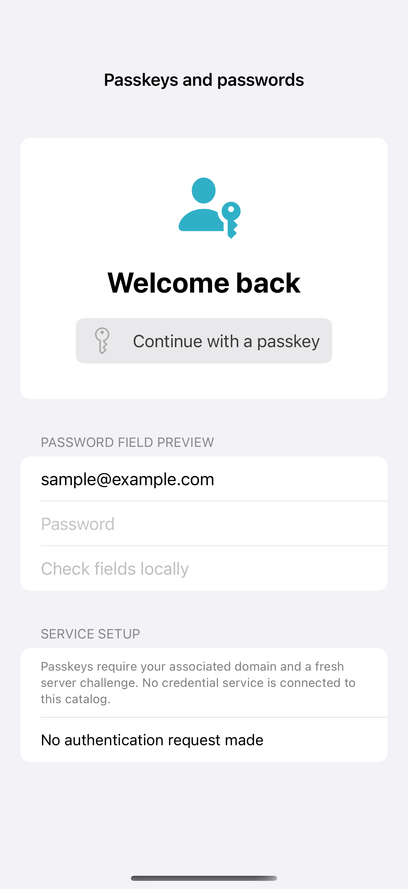

# Passkeys and password fields

Passkey authorization needs a relying-party domain, associated-domain entitlement, and a fresh challenge from a real service; those are intentionally absent here, so its request button stays disabled. Native username and secure-password fields demonstrate AutoFill hints locally, while the full request path handles an assertion without claiming that backend verification has succeeded.

## SwiftUI

```swift
import SwiftUI
import AuthenticationServices

struct PasskeyRecipe: View {
    @Environment(\.authorizationController) private var authorization
    let relyingParty: String? = nil // Supply your configured relying-party domain.
    let challenge: Data? = nil // Supply a fresh, server-issued challenge.
    @State private var status = "Service configuration required"
    var body: some View {
        VStack(spacing: 20) {
            Button("Continue with a passkey") {
                guard let relyingParty, let challenge else { return }
                Task {
                    do {
                        let provider = ASAuthorizationPlatformPublicKeyCredentialProvider(relyingPartyIdentifier: relyingParty)
                        _ = try await authorization.performRequest(provider.createCredentialAssertionRequest(challenge: challenge))
                        status = "Assertion received; server verification required"
                    } catch { status = "Authorization cancelled or failed" }
                }
            }.disabled(relyingParty == nil || challenge == nil)
            Text(status).font(.caption)
        }.padding()
    }
}
```

## Captures

<!-- captures:start -->
### iPhone 16 Pro · iOS 18.5

default. light appearance; Large text; en_US.


<!-- captures:end -->

## Full example

[Open the complete runnable example](PasskeysPasswordsDemo.swift).

## Reference

[Apple: Supporting passkeys](https://developer.apple.com/documentation/authenticationservices/supporting-passkeys).
