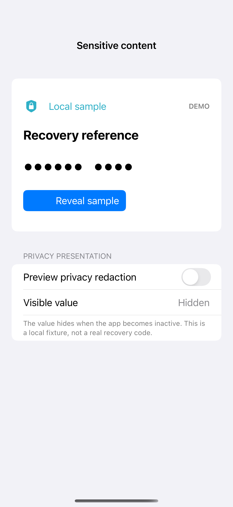

# Sensitive content and reveal controls

Sensitive content can start concealed, reveal through an explicit control, and hide again when the scene becomes inactive. Keep the accessibility representation concealed too. The privacySensitive modifier adds a system privacy hint; it does not prevent screenshots or replace encryption, access control, or secure storage. All values here are clearly marked local fixtures.

## SwiftUI

```swift
import SwiftUI

struct SensitiveRevealRecipe: View {
    @Environment(\.scenePhase) private var scenePhase
    @State private var revealed = false
    var body: some View {
        VStack(spacing: 24) {
            Text(revealed ? "SAMPLE 4821" : "•••••• ••••")
                .font(.title.monospaced()).privacySensitive()
                .accessibilityLabel(revealed ? "Sample value, 4821" : "Sample value hidden")
            Button(revealed ? "Hide sample" : "Reveal sample") { revealed.toggle() }
        }.padding()
        .onChange(of: scenePhase) { _, phase in if phase != .active { revealed = false } }
    }
}
```

## Captures

<!-- captures:start -->
### iPhone 16 Pro · iOS 18.5

default. light appearance; Large text; en_US.


<!-- captures:end -->

## Full example

[Open the complete runnable example](SensitiveContentRevealDemo.swift).

## Reference

[Apple: privacySensitive](https://developer.apple.com/documentation/swiftui/view/privacysensitive(_:)).
