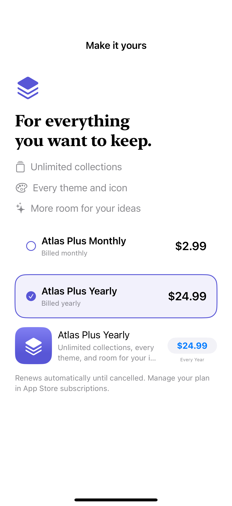
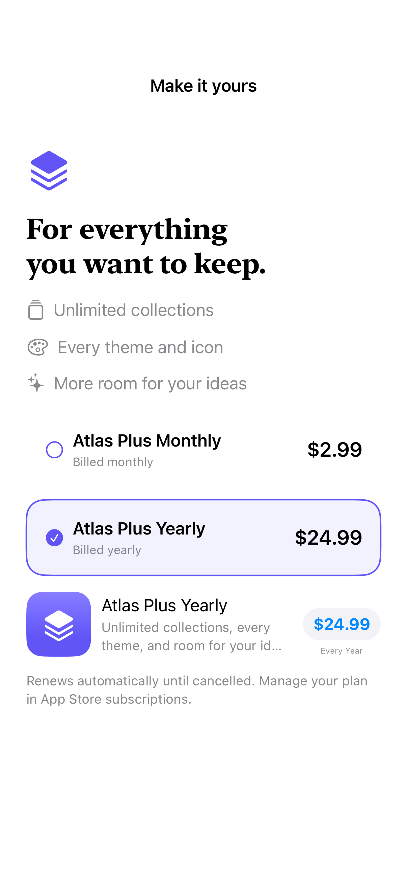

# Custom plan comparison

App-specific benefits and selection can surround real StoreKit product metadata and a native purchase control.

## SwiftUI

```swift
import SwiftUI
import StoreKit

struct StoreKitPriceChoice: View {
    let products: [Product]
    @State private var selected: Product.ID?
    var body: some View {
        VStack {
            ForEach(products) { product in
                Button { selected = product.id } label: {
                    HStack {
                        Text(product.displayName)
                        Spacer()
                        Text(product.displayPrice)
                    }
                }
            }
            if let product = products.first(where: { $0.id == selected }) {
                ProductView(product).productViewStyle(.compact)
            }
        }
    }
}
```

## Captures

<!-- captures:start -->
### iPhone 16 Pro · iOS 18.5

default. light appearance; Large text; en_US.



### iPhone 18 Pro · iOS 27.0

default. light appearance; Large text; en_US.


<!-- captures:end -->

## Example notes

The plan rows and fictional benefits are custom app UI. Prices come from Product.displayPrice and billing units from the Product subscription period; the explanatory billing phrases are English fixture copy. The purchase control remains a real ProductView. This is a composition example, not production entitlement delivery or a production legal disclosure template.

## Local StoreKit setup

Use the shared [AtlasPurchases.storekit](../AtlasPurchases.storekit) fixture. See [integration and capture rules](../STOREKIT.md).


## Full example

[Open the complete runnable example](CustomPlanComparisonDemo.swift).

## Reference

[Apple documentation](https://developer.apple.com/documentation/storekit/product/displayprice).
