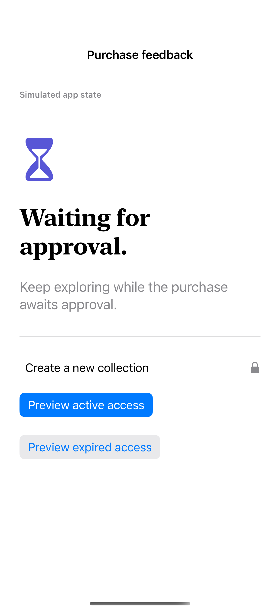
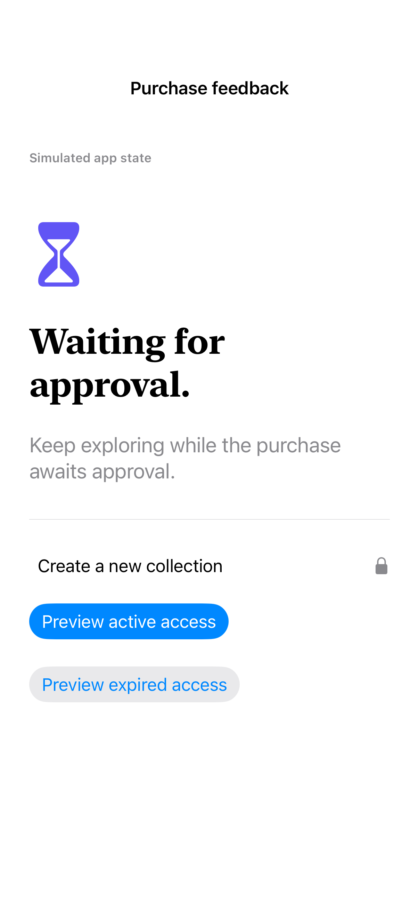

# App purchase and access states

Explicit app-level states distinguish progress, cancellation, approval, errors, and access without imitating a system payment sheet.

## SwiftUI

```swift
import SwiftUI

struct PendingPurchaseFeedback: View {
    var body: some View {
        ContentUnavailableView("Waiting for approval", systemImage: "hourglass", description: Text("Keep exploring. Access changes only after a verified purchase arrives."))
    }
}
```

## Captures

<!-- captures:start -->
### iPhone 16 Pro · iOS 18.5

default. light appearance; Large text; en_US.



### iPhone 17 Pro · iOS 26.5

default. light appearance; Large text; en_US.


### iPhone 18 Pro · iOS 27.0

default. light appearance; Large text; en_US.


<!-- captures:end -->

## Example notes

Every state in this gallery is an explicit local fixture. No StoreKit transaction, confirmation dialog, entitlement, or payment is simulated as authentic system UI. Controls only change app presentation. In production, drive these states from verified StoreKit results and transaction updates; cancellation and pending approval do not grant access.

## Full example

[Open the complete runnable example](PurchaseStateGalleryDemo.swift).

## Reference

[Apple documentation](https://developer.apple.com/documentation/storekit/product/purchaseresult).
