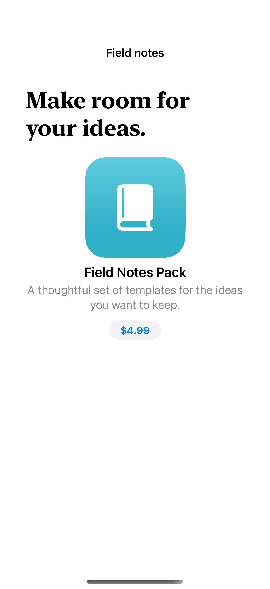
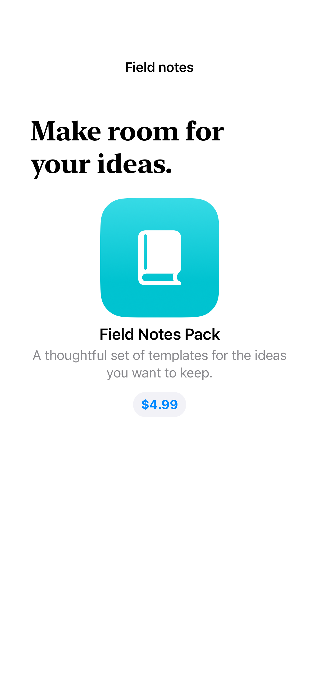

# Native product views

ProductView presents a StoreKit product with localized metadata and a native purchase control.

## SwiftUI

```swift
import SwiftUI
import StoreKit

struct NativeProductCard: View {
    var body: some View {
        ProductView(id: "dev.iosdesignatlas.fixture.notes") {
            Image(systemName: "book.closed.fill").font(.largeTitle)
        }
        .productViewStyle(.large)
    }
}
```

## Captures

<!-- captures:start -->
### iPhone 16 Pro · iOS 18.5

default. light appearance; Large text; en_US.



### iPhone 18 Pro · iOS 27.0

default. light appearance; Large text; en_US.


<!-- captures:end -->

## Example notes

The fictional Field Notes Pack comes from AtlasPurchases.storekit. The three product styles render the same real Product metadata. Without the local configuration, the full example shows an honest setup state. A verified local purchase updates session feedback and finishes its transaction; no production entitlement service is implemented. Captures only load metadata and never activate a purchase.

## Local StoreKit setup

Use the shared [AtlasPurchases.storekit](../AtlasPurchases.storekit) fixture. See [integration and capture rules](../STOREKIT.md).


## Full example

[Open the complete runnable example](StoreKitProductViewDemo.swift).

## Reference

[Apple documentation](https://developer.apple.com/documentation/storekit/productview).
