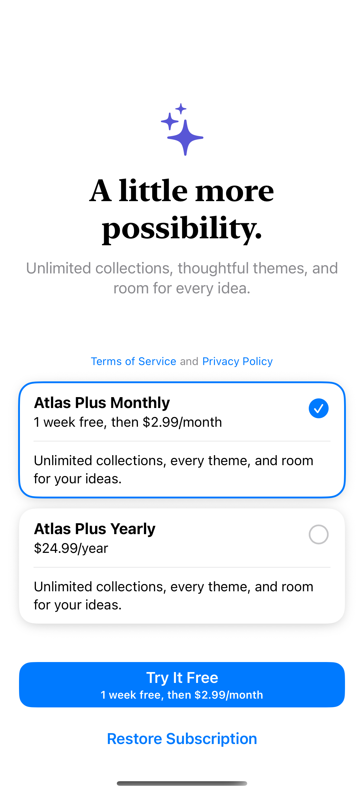
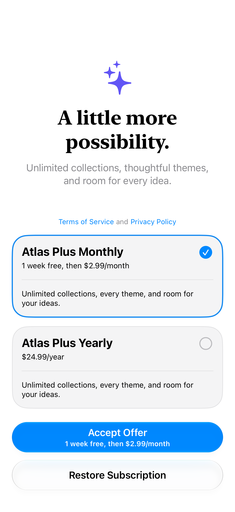

# Native subscription choices

SubscriptionStoreView presents plan choices, billing details, introductory eligibility, and a native subscription action.

## SwiftUI

```swift
import SwiftUI
import StoreKit

struct NativeSubscriptionPlans: View {
    var body: some View {
        SubscriptionStoreView(productIDs: ["dev.iosdesignatlas.fixture.plus.monthly", "dev.iosdesignatlas.fixture.plus.yearly"]) {
            Text("Make room for every idea.").font(.title.bold())
        }
        .subscriptionStoreControlStyle(.prominentPicker)
        .subscriptionStoreButtonLabel(.multiline)
        .storeButton(.visible, for: .restorePurchases)
    }
}
```

## Captures

<!-- captures:start -->
### iPhone 16 Pro · iOS 18.5

default. light appearance; Large text; en_US.



### iPhone 18 Pro · iOS 27.0

default. light appearance; Large text; en_US.


<!-- captures:end -->

## Example notes

The local fixture defines monthly and yearly plans in one fictional subscription group. StoreKit supplies localized prices, billing periods, and introductory-offer eligibility. Trial messaging depends on the test session’s history and eligibility, not a hardcoded banner. Policy destinations explicitly describe this local example; they are not production legal documents. Capture never taps Subscribe or Restore Purchases.

## Local StoreKit setup

Use the shared [AtlasPurchases.storekit](../AtlasPurchases.storekit) fixture. See [integration and capture rules](../STOREKIT.md).


## Full example

[Open the complete runnable example](StoreKitSubscriptionViewDemo.swift).

## Reference

[Apple documentation](https://developer.apple.com/documentation/storekit/subscriptionstoreview).
