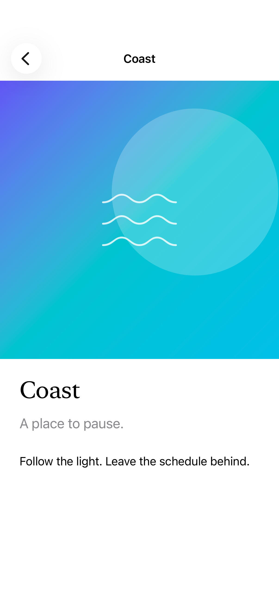

# Background extension

Background extension mirrors and blurs the edges of a view into available safe areas, including space beneath a split-view sidebar.

## SwiftUI

```swift
import SwiftUI

@available(iOS 26.0, *)
struct ExtendedHero: View {
    var body: some View {
        NavigationSplitView {
            List { Text("Coast"); Text("Forest") }
        } detail: {
            LinearGradient(colors: [.indigo, .teal],
                           startPoint: .topLeading,
                           endPoint: .bottomTrailing)
                .backgroundExtensionEffect()
        }
    }
}
```

## Captures

<!-- captures:start -->
### iPhone 18 Pro · iOS 27.0

default. light appearance; Large text; en_US.


### iPhone 17 Pro · iOS 26.5

default. light appearance; Large text; en_US.


<!-- captures:end -->

## Full example

[Open the complete runnable example](BackgroundExtensionDemo.swift).

## Reference

[Apple: backgroundExtensionEffect](https://developer.apple.com/documentation/swiftui/view/backgroundextensioneffect()).
