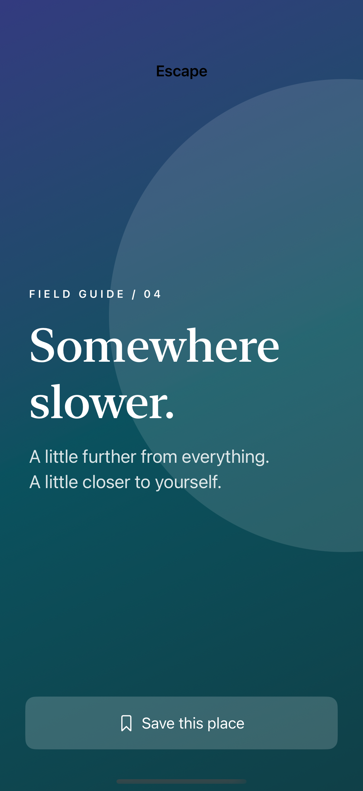
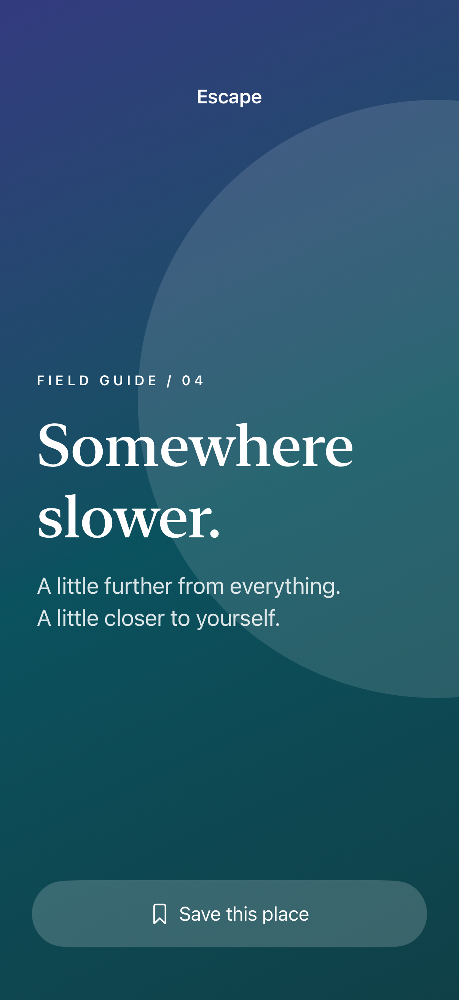

# Full-bleed backgrounds

A background can ignore the safe area while foreground content keeps the system’s clearance for bars and the home indicator.

## SwiftUI

```swift
import SwiftUI

struct EdgeToEdgeArtwork: View {
    var body: some View {
        ZStack {
            LinearGradient(colors: [.indigo, .teal],
                           startPoint: .top, endPoint: .bottom)
                .ignoresSafeArea()
            Text("Somewhere slower.")
                .font(.largeTitle).foregroundStyle(.white)
                .padding(32)
        }
        .safeAreaInset(edge: .bottom) {
            Button("Save this place") { }
                .buttonStyle(.borderedProminent).padding()
        }
    }
}
```

## Captures

<!-- captures:start -->
### iPhone 16 Pro · iOS 18.5

default. light appearance; Large text; en_US.



### iPhone 17 Pro · iOS 26.5

default. light appearance; Large text; en_US.


### iPhone 18 Pro · iOS 27.0

default. light appearance; Large text; en_US.


<!-- captures:end -->

## Full example

[Open the complete runnable example](FullBleedSafeAreasDemo.swift).

## Reference

[Apple: ignoresSafeArea](https://developer.apple.com/documentation/swiftui/view/ignoressafearea(_:edges:)).
