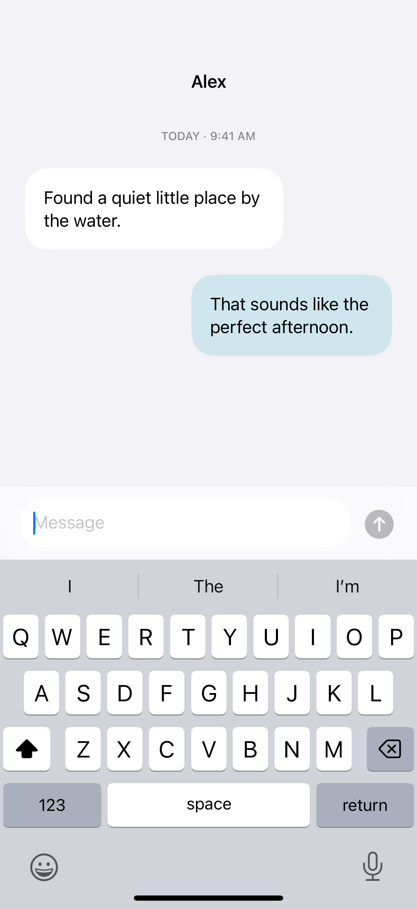
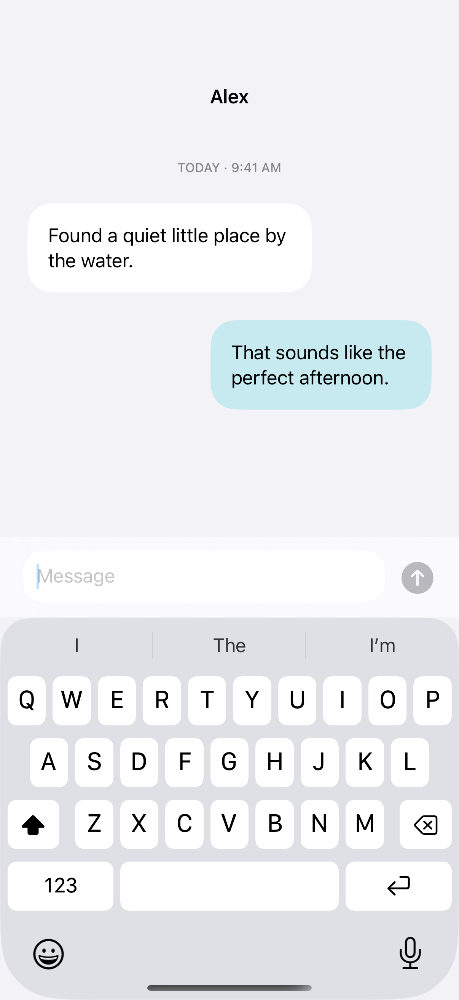

# Keyboard safe areas

A bottom inset lets a composer move with the keyboard, while ignoring safe areas only on its background preserves keyboard avoidance.

## SwiftUI

```swift
import SwiftUI

struct KeyboardComposer: View {
    @State private var message = ""
    var body: some View {
        ScrollView { Text("Conversation").padding() }
            .scrollDismissesKeyboard(.interactively)
            .safeAreaInset(edge: .bottom) {
                TextField("Message", text: $message, axis: .vertical)
                    .lineLimit(1...4).textFieldStyle(.roundedBorder)
                    .padding().background(.bar)
            }
            .background {
                Color(uiColor: .systemGroupedBackground)
                    .ignoresSafeArea()
            }
    }
}
```

## Captures

<!-- captures:start -->
### iPhone 16 Pro · iOS 18.5

default. light appearance; Large text; en_US.



### iPhone 17 Pro · iOS 26.5

default. light appearance; Large text; en_US.


<!-- captures:end -->

## Full example

[Open the complete runnable example](KeyboardSafeAreasDemo.swift).

## Reference

[Apple: safeAreaInset](https://developer.apple.com/documentation/swiftui/view/safeareainset(edge:alignment:spacing:content:)).
