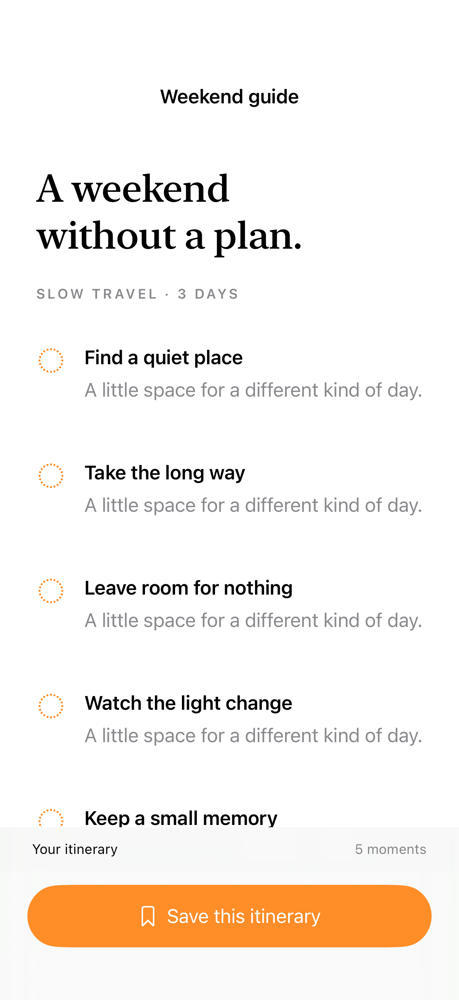
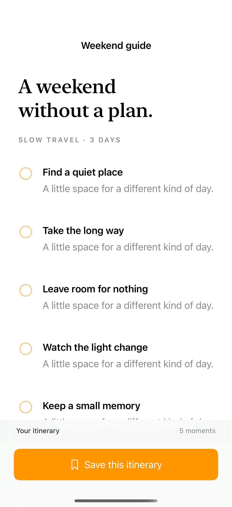
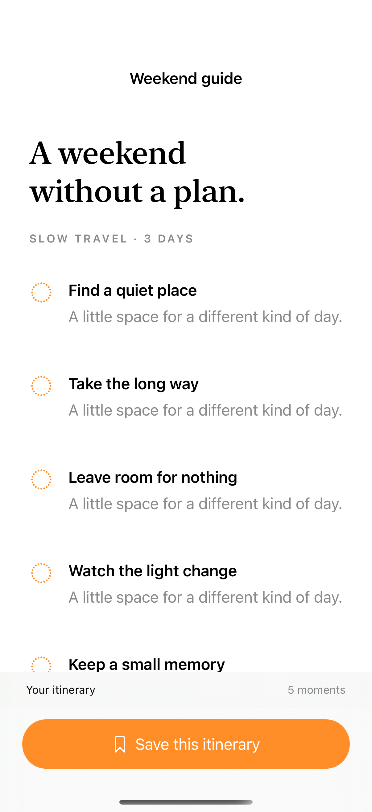

# Persistent action areas

A safe-area inset reserves room for a persistent control so scrollable content remains reachable above it.

## SwiftUI

```swift
import SwiftUI

struct PersistentAction: View {
    var body: some View {
        ScrollView {
            LazyVStack {
                ForEach(1...30, id: \.self) { Text("Stop \($0)").padding() }
            }.frame(maxWidth: .infinity)
        }
        .safeAreaInset(edge: .bottom) {
            Button("Save itinerary") { }
                .buttonStyle(.borderedProminent)
                .frame(maxWidth: .infinity)
                .padding().background(.bar)
        }
    }
}
```

## Captures

<!-- captures:start -->
### iPhone 18 Pro · iOS 27.0

default. light appearance; Large text; en_US.



### iPhone 16 Pro · iOS 18.5

default. light appearance; Large text; en_US.



### iPhone 17 Pro · iOS 26.5

default. light appearance; Large text; en_US.


<!-- captures:end -->

## Full example

[Open the complete runnable example](SafeAreaActionsDemo.swift).

## Reference

[Apple: safeAreaInset](https://developer.apple.com/documentation/swiftui/view/safeareainset(edge:alignment:spacing:content:)).
