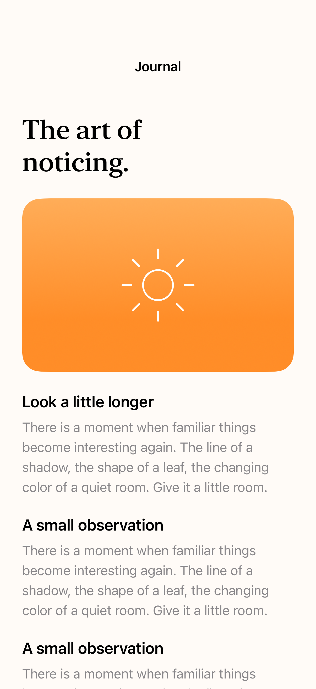
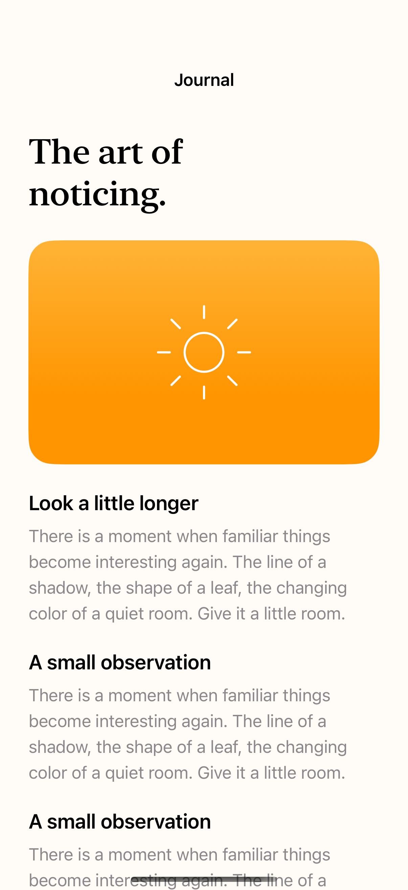
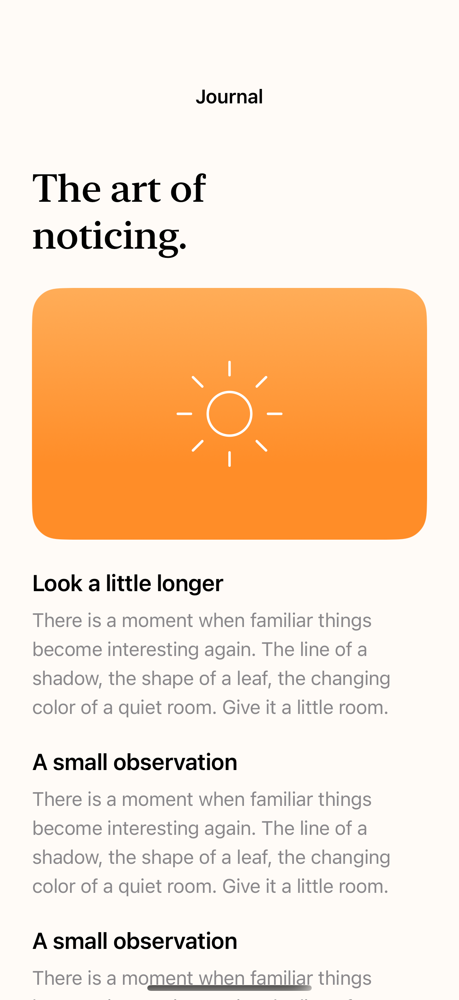

# Content and indicator margins

Content margins can move a scroll view’s content without moving its scroll indicators, or adjust each independently.

## SwiftUI

```swift
import SwiftUI

struct IndependentScrollMargins: View {
    var body: some View {
        ScrollView {
            LazyVStack(alignment: .leading) {
                ForEach(1...40, id: \.self) { Text("Observation \($0)").padding(.vertical) }
            }.frame(maxWidth: .infinity, alignment: .leading)
        }
        .contentMargins(.horizontal, 28, for: .scrollContent)
        .contentMargins(.trailing, 2, for: .scrollIndicators)
    }
}
```

## Captures

<!-- captures:start -->
### iPhone 18 Pro · iOS 27.0

default. light appearance; Large text; en_US.



### iPhone 16 Pro · iOS 18.5

default. light appearance; Large text; en_US.



### iPhone 17 Pro · iOS 26.5

default. light appearance; Large text; en_US.


<!-- captures:end -->

## Full example

[Open the complete runnable example](ScrollContentMarginsDemo.swift).

## Reference

[Apple: contentMargins](https://developer.apple.com/documentation/swiftui/view/contentmargins(_:_:for:)).
