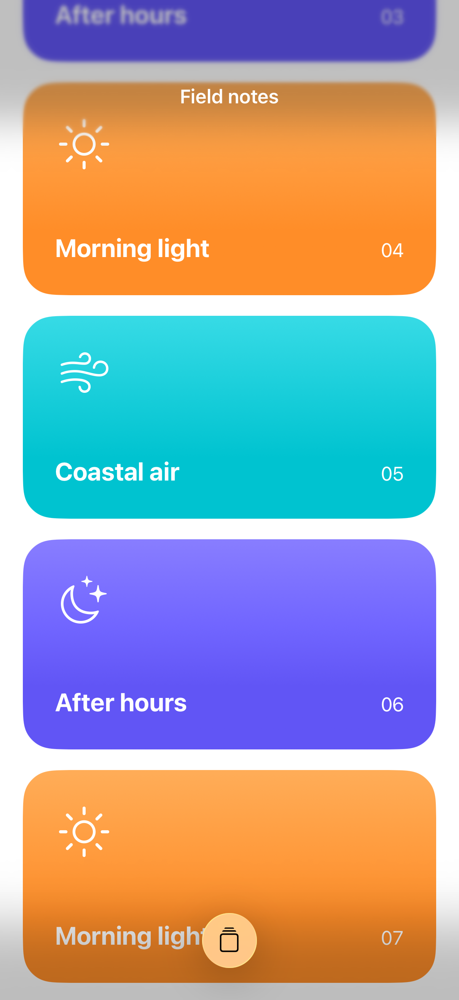
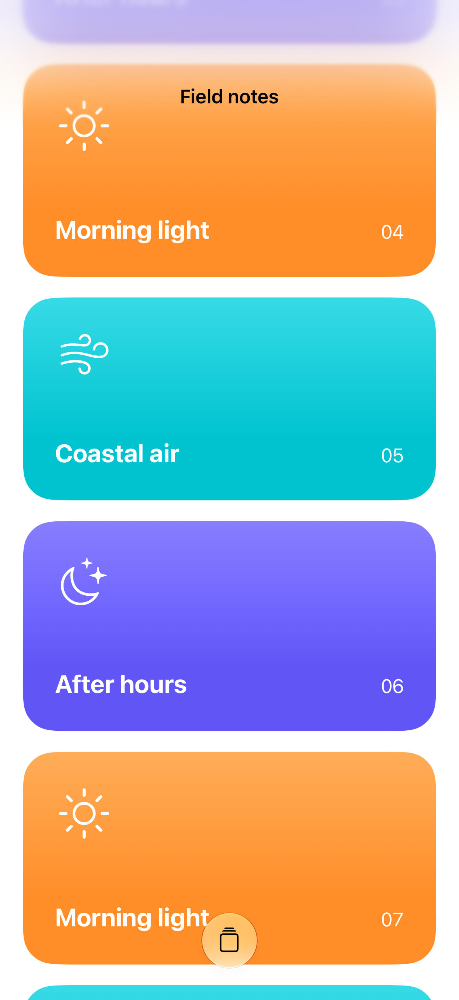

# Scroll edge styles

Scroll edge effects soften or separate content as it passes beneath system bars; the style can be set independently for each edge.

## SwiftUI

```swift
import SwiftUI

@available(iOS 26.0, *)
struct SoftScrollEdges: View {
    var body: some View {
        ScrollView {
            LazyVStack {
                ForEach(1...40, id: \.self) { number in
                    Text("Field note \(number)").padding()
                }
            }.frame(maxWidth: .infinity)
        }
        .scrollEdgeEffectStyle(.soft, for: .top)
        .scrollEdgeEffectStyle(.hard, for: .bottom)
        .navigationTitle("Field notes")
    }
}
```

## Captures

<!-- captures:start -->
### iPhone 17 Pro · iOS 26.5

default. light appearance; Large text; en_US.



### iPhone 18 Pro · iOS 27.0

default. light appearance; Large text; en_US.


<!-- captures:end -->

## Full example

[Open the complete runnable example](ScrollEdgeStylesDemo.swift).

## Reference

[Apple: scrollEdgeEffectStyle](https://developer.apple.com/documentation/swiftui/scrolledgeeffectstyle).
