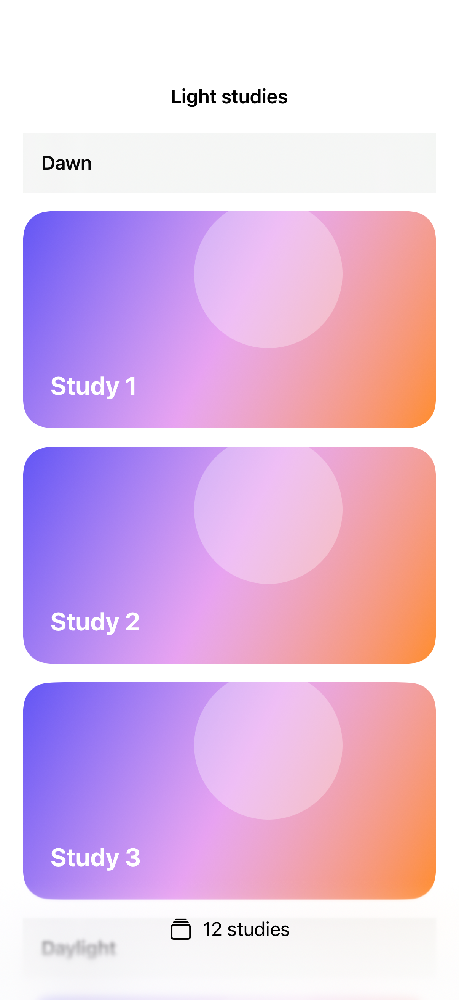
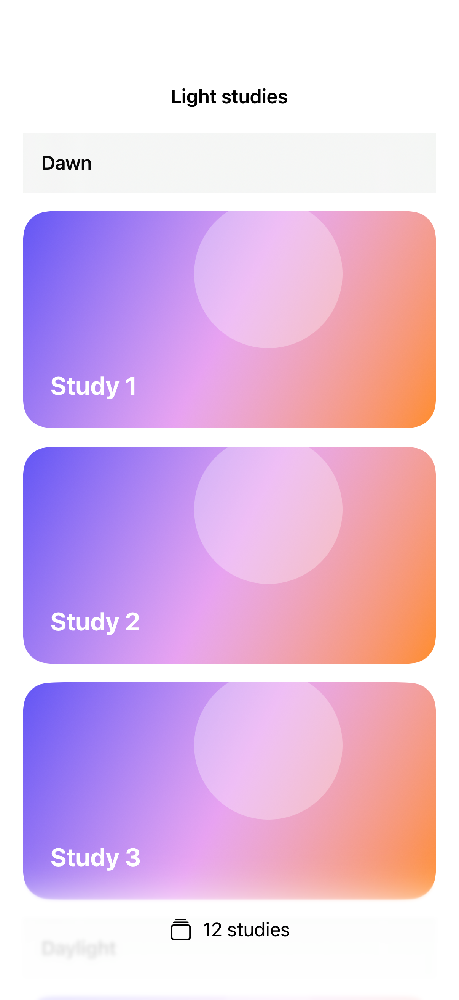

# Scroll edge visibility

Scroll edge visibility can be controlled per edge, including the leading and trailing edges of a horizontal scroller.

## SwiftUI

```swift
import SwiftUI

@available(iOS 26.0, *)
struct HiddenTopEdge: View {
    @State private var hidden = false
    var body: some View {
        ScrollView {
            VStack(spacing: 24) {
                Toggle("Hide top effect", isOn: $hidden)
                ForEach(1...30, id: \.self) { Text("Study \($0)") }
            }.padding()
        }
        .scrollEdgeEffectHidden(hidden, for: .top)
    }
}
```

## Captures

<!-- captures:start -->
### iPhone 18 Pro · iOS 27.0

default. light appearance; Large text; en_US.



### iPhone 17 Pro · iOS 26.5

default. light appearance; Large text; en_US.


<!-- captures:end -->

## Full example

[Open the complete runnable example](ScrollEdgeVisibilityDemo.swift).

## Reference

[Apple: scrollEdgeEffectHidden](https://developer.apple.com/documentation/swiftui/view/scrolledgeeffecthidden(_:for:)).
